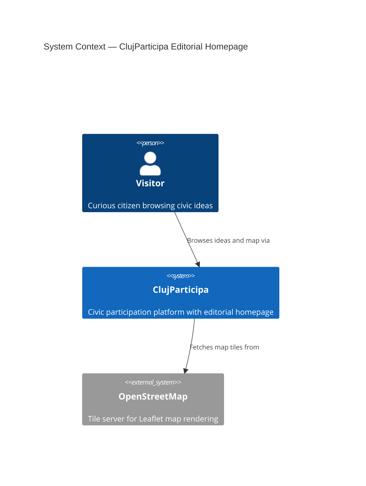
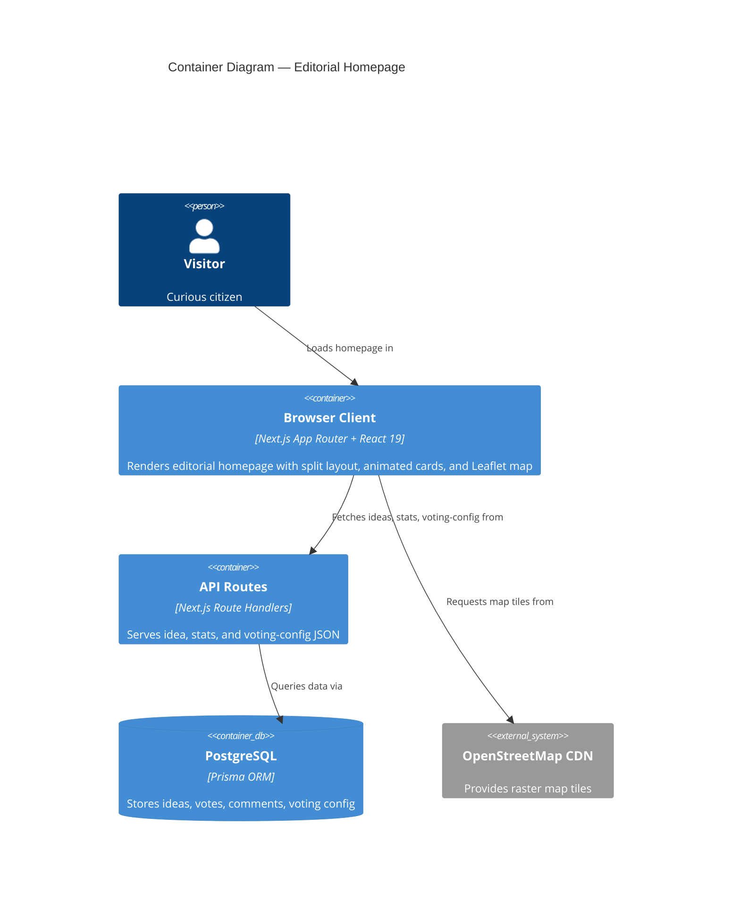
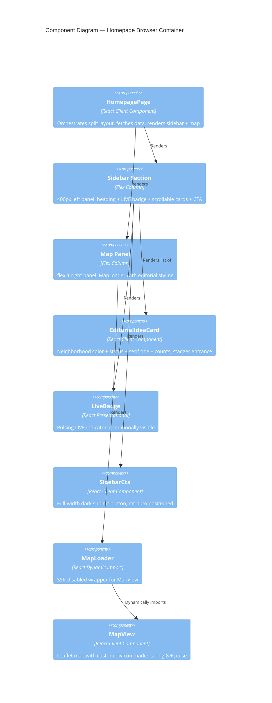

# Feature Delta — editorial-redesign

## Wave: DISCUSS / [REF] Persona ID

**First-time Visitor** — curious citizen, no account, lands on homepage via direct link or search. Wants to understand what civic ideas exist and where, feel the platform is active and credible, and optionally submit an idea.

## Wave: DISCUSS / [REF] JTBD One-liner

When I visit the civic platform, I want to see an editorial-quality homepage with a live idea feed alongside a map, so I can scan ideas by neighborhood, feel the platform is active, and decide to participate.

## Wave: DISCUSS / [REF] Locked Decisions

- [D1] Feature type: User-facing — all changes are visible UI/UX on the homepage
- [D2] Walking skeleton: Brownfield — redesign branch has existing working layout; right-sized, no split needed
- [D3] UX research depth: Lightweight — clear visual target in cp-example reference
- [D4] JTBD: Yes — 4 jobs identified with opportunity scoring
- [D5] No ticker footer — user directed to keep existing static footer; scrolling ticker removed from scope
- [D6] Framer Motion is integral, not deferred — animations are folded into layout and card slices, not a separate afterthought

## Wave: DISCUSS / [REF] User Stories

### US-1: Split Sidebar+Map Layout

**As a** visitor **I want to** see a sidebar with the idea feed alongside a map of Cluj **So that** I can browse ideas while keeping geographic context

**Job**: J2 (Scanner)

**Before**: I must scroll past a vertical idea list and then navigate to a separate map page to see where ideas are located
**After**: view the homepage → sees a two-column layout with the idea feed on the left and an interactive Leaflet map on the right
**Decision enabled**: I can scan ideas and see their map distribution simultaneously, deciding which neighborhoods to explore

**ACs**:
- Homepage renders sidebar (w-[400px]) on left and map (flex-1) on right
- Leaflet map initializes and is interactive within the right panel
- On <768px, sidebar stacks above map, both full-width
- Idea list scrolls independently within sidebar
- Header and footer unchanged
- No Leaflet/React console errors

### US-2: Framer Motion Layout Entrance

**As a** visitor **I want to** see the sidebar and map animate smoothly into view **So that** the page feels polished and alive

**Job**: J1 (Explorer), J3 (Trust-Seeker)

**Before**: the homepage appears instantly with no transition — feels like any other web app
**After**: load the homepage → sees the sidebar slide in from the left and the map fade+scale into view
**Decision enabled**: I feel the platform is polished and active, deciding to stay and explore

**ACs**:
- Sidebar: `initial={{ opacity: 0, x: -20 }}` → `animate={{ opacity: 1, x: 0 }}`
- Map: `initial={{ opacity: 0, scale: 0.98 }}` → `animate={{ opacity: 1, scale: 1 }}`
- No hydration mismatch warnings
- Animations disabled when `prefers-reduced-motion` is set
- Animated components use `use client`

### US-3: Editorial Typography

**As a** visitor **I want to** see a serif/sans typographic hierarchy with Playfair Display headings **So that** the platform feels like a credible editorial publication

**Job**: J3 (Trust-Seeker)

**Before**: headings use default sans-serif — the page looks like a standard Next.js template
**After**: view the homepage → sees Playfair Display serif on headings and Inter sans on UI elements with editorial tracking
**Decision enabled**: I perceive the platform as credible and serious, deciding to trust my participation

**ACs**:
- Playfair Display renders on heading elements
- Nav labels: `text-[11px] font-bold tracking-widest uppercase`
- Idea feed heading: `font-serif italic`
- No CLS during font swap
- All strings from locale files

### US-4: Editorial Idea Cards with Staggered Animation

**As a** visitor **I want to** see beautifully styled idea cards with neighborhood colors and entrance animations **So that** I can quickly scan ideas and feel the platform is active

**Job**: J1 (Explorer), J2 (Scanner)

**Before**: idea list items are plain rows with minimal visual distinction
**After**: view the homepage → sees color-coded idea cards with serif titles, neighborhood labels, status badges, and staggered fade+slide animation
**Decision enabled**: I can quickly identify ideas in my neighborhood and gauge their status

**ACs**:
- Each card: neighborhood (color-coded), status badge, serif title, support count, comment count
- Title: `font-serif font-medium`, hover underline (`underline-offset-8`)
- Category colors from `category-colors.ts`
- Staggered fade+slide (0.1s delay per card)
- ThumbsUp/MessageSquare icons on counts
- All strings from locale files

### US-5: LIVE Activity Badge

**As a** visitor **I want to** see a "LIVE" badge on the idea feed **So that** I immediately sense the platform is active

**Job**: J1 (Explorer)

**Before**: no indication the platform is active — could be abandoned
**After**: view the homepage → sees a pulsing "LIVE" badge next to the idea feed heading (when ideas or voting exist)
**Decision enabled**: I feel the platform is active, deciding to engage rather than leave

**ACs**:
- LIVE badge appears when `votingConfig.isOpen` OR >0 ideas exist
- Badge: `bg-ink text-paper`, `animate-pulse`
- Hidden when no ideas and no voting
- Badge text from locale files

### US-6: Animated Map Pins

**As a** visitor **I want to** see colored animated pins on the map representing ideas by neighborhood **So that** I can see where civic activity is concentrated

**Job**: J2 (Scanner)

**Before**: map shows default blue Leaflet markers — uniform and uninformative
**After**: view the homepage map → sees colored circle markers with pulse animations, colored by category, with hover tooltips
**Decision enabled**: I can see which neighborhoods have the most activity, deciding where to focus

**ACs**:
- Colored circle markers (not default blue pins)
- Color-coded by category (`category-colors.ts`)
- Active markers pulse
- Hover shows tooltip with location name
- Map remains interactive
- No rendering errors

### US-7: Sidebar CTA Button

**As a** visitor **I want to** see a prominent "Submit your idea" button at the sidebar bottom **So that** I can easily move from browsing to contributing

**Job**: J4 (Contributor)

**Before**: submit button is in the hero section and may be off-screen
**After**: view the homepage → sees a full-width dark "Trimite Ideea Ta" button pinned to the sidebar bottom
**Decision enabled**: I can submit my idea immediately after browsing, without scrolling back up

**ACs**:
- CTA at sidebar bottom, full-width
- `bg-ink text-paper`, `mt-auto` positioning
- Send icon + uppercase tracking-wide label
- Old hero CTA removed
- Stays visible regardless of list length
- All strings from locale files

## Wave: DISCUSS / [REF] Definition of Done

1. All 7 user stories implemented and ACs passing
2. Homepage renders split sidebar+map layout on desktop
3. Layout stacks vertically on mobile (<768px)
4. Framer Motion animations work without hydration errors
5. Playfair Display loads without CLS
6. LIVE badge shows/hides based on activity
7. Custom map pins replace default Leaflet markers
8. CTA button at sidebar bottom with `mt-auto`
9. All visible strings from locale files

## Wave: DISCUSS / [REF] Out of Scope

- Scrolling ticker footer (user directed to keep existing static footer)
- Changes to header or footer components
- Changes to other pages (idea detail, map page, admin)
- PostGIS migration (per CLAUDE.md: use plain lat/long floats)
- react-leaflet major version upgrade (per CLAUDE.md)
- Any new API endpoints (all required APIs already exist)

## Wave: DISCUSS / [REF] WS Strategy

**B** — Brownfield. The redesign branch has an existing working layout. We restructure it rather than build from scratch.

## Wave: DISCUSS / [REF] Driving Ports

| Port | Type | Description |
|------|------|-------------|
| Homepage `/` | HTTP (SSR) | Main entry point — split layout renders server-side, hydrates with motion |
| `/api/ideas` | HTTP (API) | Idea feed data for sidebar + map pins |
| `/api/stats` | HTTP (API) | Total stats for LIVE badge and map overlay |
| `/api/voting-config` | HTTP (API) | Voting status for LIVE badge visibility |

## Wave: DISCUSS / [REF] Prerequisites

- Redesign branch must be checked out and working
- `react-leaflet` already integrated (exists on redesign branch)
- APIs (`/api/ideas`, `/api/stats`, `/api/voting-config`) already functional on redesign branch

---

## Wave: DESIGN / [REF] DDD List

| D# | Decision | Verdict | Rationale |
|----|----------|---------|-----------|
| D01 | Layout: grid vs flex | Flex with fixed sidebar | react-leaflet needs explicit height; flex `h-[calc(100vh-header-footer)]` propagates naturally vs fragile `h-full` chaining through grid cells |
| D02 | Font: Source Serif 4 → Playfair Display | Switch via `next/font/google` | Source Serif 4 has zero references in codebase. Playfair Display is the editorial target. `next/font` gives auto-subset, `font-display: swap`, zero CLS, self-hosted |
| D03 | Motion: `framer-motion` vs `motion` | `motion` v12.x | Canonical successor. Same API. Import from `motion/react` matches cp-example. ~18KB gzipped |
| D04 | SSR pattern for motion | `use client` + conditional rendering | Homepage is already `"use client"`. No dynamic import needed. `prefers-reduced-motion` handled via built-in motion support |
| D05 | IdeaCard vs new EditorialIdeaCard | CREATE new component | Different structure (no image, no border, neighborhood+dot+status line). Extending IdeaCard with variant would double conditional branches |
| D06 | Map markers: extend markerIcon | EXTEND existing `markerIcon()` | Already uses `L.divIcon` with inline HTML. Extend signature to `markerIcon(status, category, neighborhood)`. Add ring-8, pulse, tooltip |
| D07 | Data fetching: consolidate or separate | Keep separate, co-locate in page | Different query shapes. No new API endpoint. Move map fetch from HomeMapPreview into page, pass ideas as prop |
| D08 | CTA link: `next/link` or `<a>` | `Link` from `@/i18n/navigation` | Preserves locale in URL. All internal navigation uses this pattern |
| D09 | LIVE badge visibility | Show when `votingConfig.isOpen` OR `totalIdeas > 0` | Hide when both false. On first load before fetch: hidden (no flash) |
| D10 | Mobile breakpoint | `md:` (768px) | Matches US-1 AC. `flex-col` below, `flex-row` above |

## Wave: DESIGN / [REF] Component Decomposition

| Component | Path | Change | Description |
|-----------|------|--------|-------------|
| Homepage | `src/app/[locale]/page.tsx` | REFACTOR | Split sidebar+map flex layout. Fetch stats + ideas. Orchestrate motion + typography. Remove hero CTA |
| Layout | `src/app/[locale]/layout.tsx` | EXTEND | Replace Geist Sans with Inter. Add Playfair Display. Wire CSS variables. Remove Source Serif 4 |
| EditorialIdeaCard | `src/components/ideas/editorial-idea-card.tsx` | CREATE | Neighborhood label + dot + status, serif title, counts with icons, Framer Motion stagger |
| LiveBadge | `src/components/ui/live-badge.tsx` | CREATE | `bg-ink text-paper animate-pulse`, conditionally visible |
| SidebarCta | `src/components/ideas/sidebar-cta.tsx` | CREATE | Full-width dark button, `mt-auto`, Send icon, Link to `/ideas/new` |
| MapView | `src/components/map/map-view.tsx` | EXTEND | Extend `markerIcon` to accept category + neighborhood. Add ring-8, pulse, tooltip |
| MapLoader | `src/components/map/map-loader.tsx` | EXTEND | Loading placeholder `h-full` for flex container |
| globals.css | `src/app/globals.css` | EXTEND | Add `--font-serif`, `--font-sans` theme variables, selection styles |
| Locale files | `src/i18n/messages/{ro,en,hu}.json` | EXTEND | Add `Home.liveBadge`, `Home.sendIdea` keys |

## Wave: DESIGN / [REF] Driving Ports

| Port | Type | Consumer | Description |
|------|------|----------|-------------|
| `GET /` | HTTP (SSR + client hydration) | Visitor browser | Server renders layout shell, client hydrates with motion + data |
| `GET /api/stats` | HTTP (API, JSON) | Homepage client | `totalIdeas`, `totalVotes`, `totalComments`, `recentIdeas[]`, `statusCounts` |
| `GET /api/ideas?limit=50` | HTTP (API, JSON) | Homepage client | Ideas with lat/long for map + sidebar |
| `GET /api/voting-config` | HTTP (API, JSON) | Homepage client | `config.isOpen` for LIVE badge |

## Wave: DESIGN / [REF] Driven Ports + Adapters

| Port | Adapter | Technology | Description |
|------|---------|------------|-------------|
| DB read (ideas) | Prisma Client | `@prisma/client` via `/api/ideas` | Queries ideas with coordinates, category, district, status, counts |
| DB read (stats) | Prisma Client | `@prisma/client` via `/api/stats` | Aggregates totals and recent ideas |
| DB read (voting config) | Prisma Client | `@prisma/client` via `/api/voting-config` | Reads voting period, computes `isOpen` |
| Tile server (read-only) | HTTP GET | OpenStreetMap CDN | Map tiles fetched by Leaflet. No API key |
| Font delivery (build-time) | `next/font/google` | Next.js build | Playfair Display + Inter downloaded at build, self-hosted |

## Wave: DESIGN / [REF] Technology Choices

| Technology | Version | Rationale |
|------------|---------|-----------|
| `motion` | `^12.23.0` | Canonical v12+ package. Import from `motion/react`. Matches cp-example. ~18KB gzipped |
| `next/font/google` (Playfair_Display) | built-in | Self-hosted, auto-subset, `font-display: swap`, zero CLS. Weights: 400, 700. Styles: normal, italic |
| `next/font/google` (Inter) | built-in | Replaces Geist Sans. Matches cp-example editorial body font. Weights: 400-800 |
| `lucide-react` | `^0.546.0` | ThumbsUp, MessageSquare, Send icons (matches cp-example) |
| `react-leaflet` | `^5.0.0` (existing) | No upgrade per CLAUDE.md. Extended markerIcon works with v5 API |
| `tailwindcss` | `^4` (existing) | ring-8, animate-pulse available natively in v4 |

## Wave: DESIGN / [REF] Reuse Analysis

| Existing Component | Overlap With | Decision | Justification |
|--------------------|-------------|----------|---------------|
| `IdeaCard` | US-4 editorial cards | CREATE NEW | Different structure: no image, no border, neighborhood+dot+status line. Variant would double conditionals |
| `map-view.tsx` `markerIcon()` | US-6 animated pins | EXTEND | Already uses `L.divIcon`. Extend signature + HTML template. Same function, richer output |
| `map-loader.tsx` | US-1 map panel | EXTEND | Change placeholder height to `h-full` for flex container |
| `Badge` (`src/components/ui/badge.tsx`) | US-4 status badge | REUSE | Has all variants. EditorialIdeaCard imports directly |
| `status.ts` `statusToBadgeVariant` | US-4 status badge | REUSE | Maps status → BadgeVariant. No change |
| `globals.css` theme variables | US-1, US-3 colors | EXTEND | Add `--font-serif`, `--font-sans`, selection styles |
| `layout.tsx` font loading | US-3 typography | EXTEND | Add Playfair_Display + Inter via `next/font/google`. Wire CSS vars |
| `page.tsx` data fetch pattern | US-5, US-7 | EXTEND | Add ideas + voting-config fetches. Pass data as props |

## Wave: DESIGN / [REF] Open Questions

| # | Question | Why Deferred | Resolution Path |
|---|----------|-------------|-----------------|
| OQ-1 | Remove Geist Sans or keep as fallback? | Low-risk cosmetic. Removal saves ~15KB but may affect other pages | During GREEN: audit `font-sans` references. If none outside homepage, remove |
| OQ-2 | How many recent ideas in sidebar? | Content decision, not architectural | DISTILL: confirm with PO. Default: keep 5, scrollable |
| OQ-3 | Pulse on ALL pins or only active ones? | Interaction design nuance | DELIVER: pulse on IN_PROGRESS + SELECTED. Static ring-8 on others |
| OQ-4 | LIVE badge pulse + `prefers-reduced-motion`? | Accessibility detail | GREEN: add `motion-reduce:animate-none` |
| OQ-5 | Map overlay from cp-example | Not in any user story | Future feature if requested |
| OQ-6 | LIVE badge locale key values | Translation needs RO/HU/EN | GREEN: `"liveBadge": "LIVE"` in all three (universal signal word) |

## Wave: DESIGN / [REF] C4 System Context

## Wave: DESIGN / [REF] C4 Container

## Wave: DESIGN / [REF] C4 Component — Homepage

