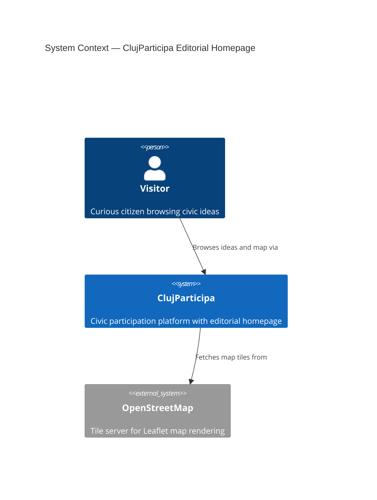
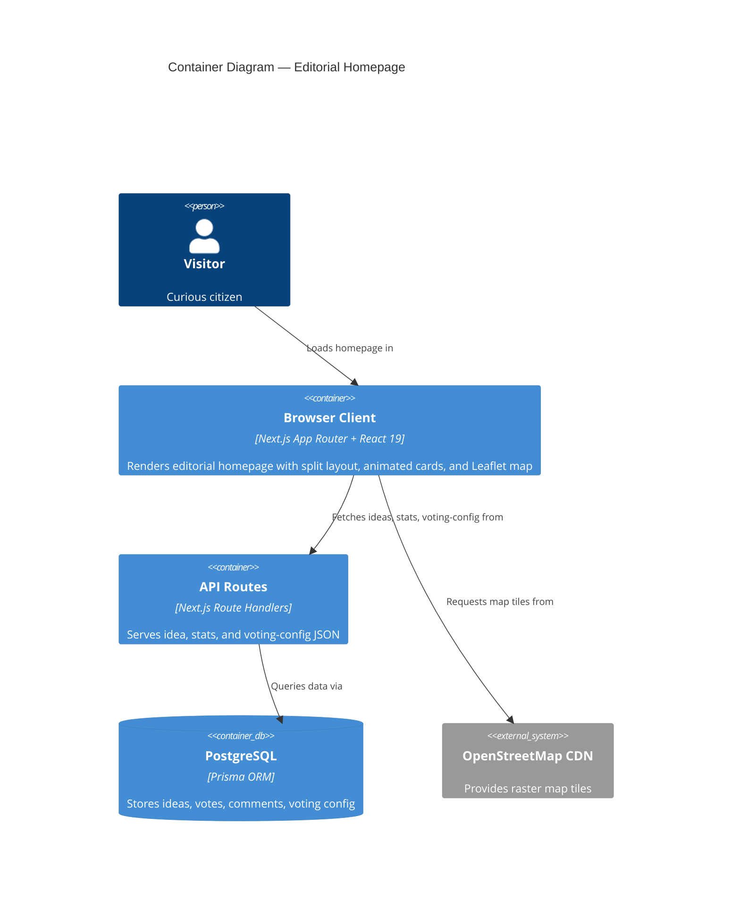
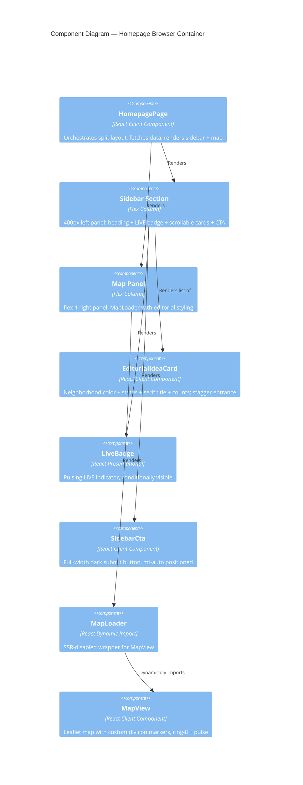
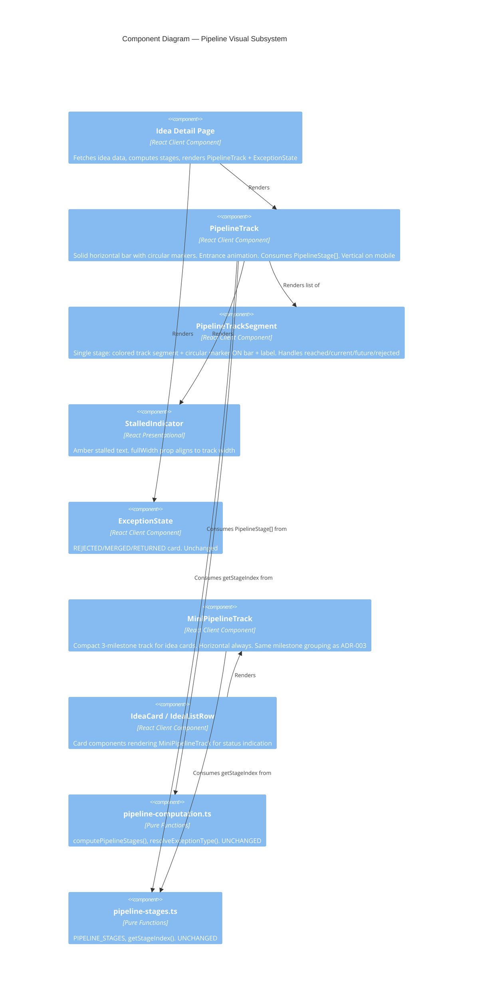
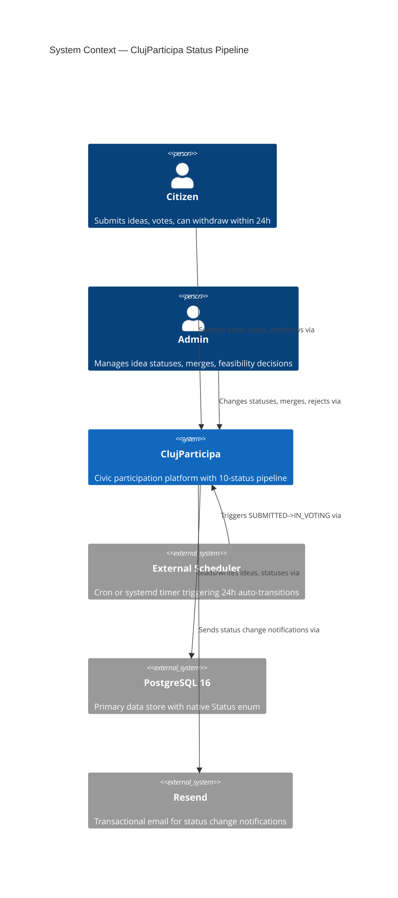
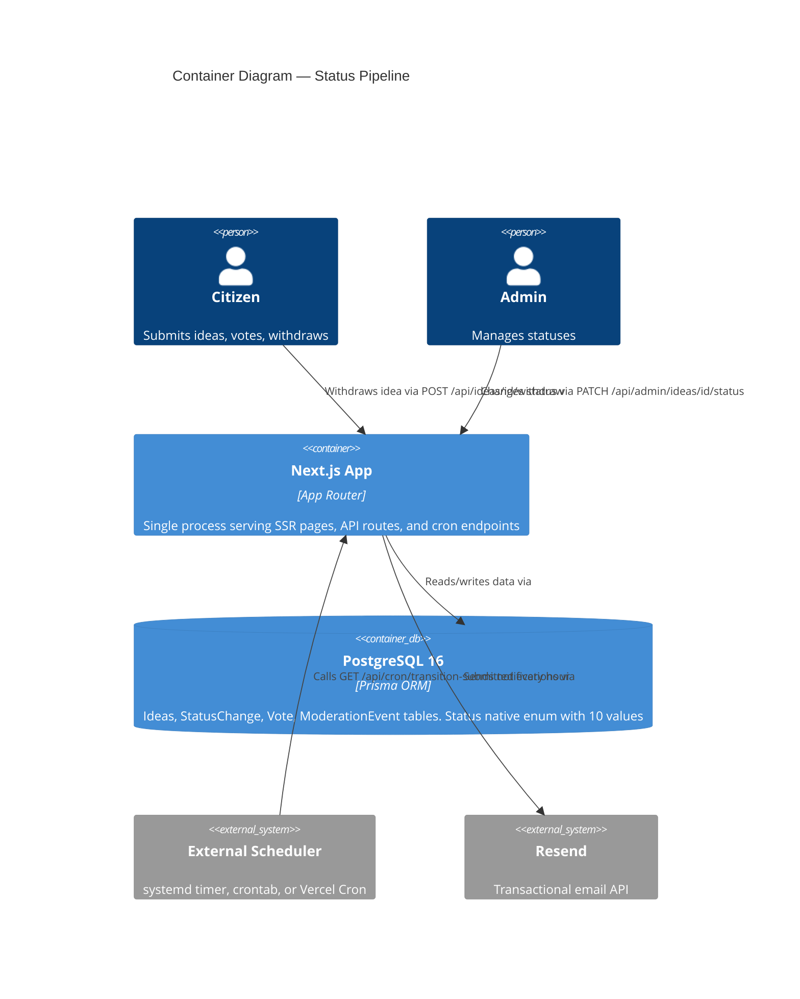

# Feature Delta — editorial-redesign

## Wave: DISCUSS / [REF] Persona ID

**First-time Visitor** — curious citizen, no account, lands on homepage via direct link or search. Wants to understand what civic ideas exist and where, feel the platform is active and credible, and optionally submit an idea.

## Wave: DISCUSS / [REF] JTBD One-liner

When I visit the civic platform, I want to see an editorial-quality homepage with a live idea feed alongside a map, so I can scan ideas by neighborhood, feel the platform is active, and decide to participate.

## Wave: DISCUSS / [REF] Locked Decisions

- [D1] Feature type: User-facing — all changes are visible UI/UX on the homepage
- [D2] Walking skeleton: Brownfield — redesign branch has existing working layout; right-sized, no split needed
- [D3] UX research depth: Lightweight — clear visual target in cp-example reference
- [D4] JTBD: Yes — 4 jobs identified with opportunity scoring
- [D5] No ticker footer — user directed to keep existing static footer; scrolling ticker removed from scope
- [D6] Framer Motion is integral, not deferred — animations are folded into layout and card slices, not a separate afterthought

## Wave: DISCUSS / [REF] User Stories

### US-1: Split Sidebar+Map Layout

**As a** visitor **I want to** see a sidebar with the idea feed alongside a map of Cluj **So that** I can browse ideas while keeping geographic context

**Job**: J2 (Scanner)

**Before**: I must scroll past a vertical idea list and then navigate to a separate map page to see where ideas are located
**After**: view the homepage → sees a two-column layout with the idea feed on the left and an interactive Leaflet map on the right
**Decision enabled**: I can scan ideas and see their map distribution simultaneously, deciding which neighborhoods to explore

**ACs**:
- Homepage renders sidebar (w-[400px]) on left and map (flex-1) on right
- Leaflet map initializes and is interactive within the right panel
- On <768px, sidebar stacks above map, both full-width
- Idea list scrolls independently within sidebar
- Header and footer unchanged
- No Leaflet/React console errors

### US-2: Framer Motion Layout Entrance

**As a** visitor **I want to** see the sidebar and map animate smoothly into view **So that** the page feels polished and alive

**Job**: J1 (Explorer), J3 (Trust-Seeker)

**Before**: the homepage appears instantly with no transition — feels like any other web app
**After**: load the homepage → sees the sidebar slide in from the left and the map fade+scale into view
**Decision enabled**: I feel the platform is polished and active, deciding to stay and explore

**ACs**:
- Sidebar: `initial={{ opacity: 0, x: -20 }}` → `animate={{ opacity: 1, x: 0 }}`
- Map: `initial={{ opacity: 0, scale: 0.98 }}` → `animate={{ opacity: 1, scale: 1 }}`
- No hydration mismatch warnings
- Animations disabled when `prefers-reduced-motion` is set
- Animated components use `use client`

### US-3: Editorial Typography

**As a** visitor **I want to** see a serif/sans typographic hierarchy with Playfair Display headings **So that** the platform feels like a credible editorial publication

**Job**: J3 (Trust-Seeker)

**Before**: headings use default sans-serif — the page looks like a standard Next.js template
**After**: view the homepage → sees Playfair Display serif on headings and Inter sans on UI elements with editorial tracking
**Decision enabled**: I perceive the platform as credible and serious, deciding to trust my participation

**ACs**:
- Playfair Display renders on heading elements
- Nav labels: `text-[11px] font-bold tracking-widest uppercase`
- Idea feed heading: `font-serif italic`
- No CLS during font swap
- All strings from locale files

### US-4: Editorial Idea Cards with Staggered Animation

**As a** visitor **I want to** see beautifully styled idea cards with neighborhood colors and entrance animations **So that** I can quickly scan ideas and feel the platform is active

**Job**: J1 (Explorer), J2 (Scanner)

**Before**: idea list items are plain rows with minimal visual distinction
**After**: view the homepage → sees color-coded idea cards with serif titles, neighborhood labels, status badges, and staggered fade+slide animation
**Decision enabled**: I can quickly identify ideas in my neighborhood and gauge their status

**ACs**:
- Each card: neighborhood (color-coded), status badge, serif title, support count, comment count
- Title: `font-serif font-medium`, hover underline (`underline-offset-8`)
- Category colors from `category-colors.ts`
- Staggered fade+slide (0.1s delay per card)
- ThumbsUp/MessageSquare icons on counts
- All strings from locale files

### US-5: LIVE Activity Badge

**As a** visitor **I want to** see a "LIVE" badge on the idea feed **So that** I immediately sense the platform is active

**Job**: J1 (Explorer)

**Before**: no indication the platform is active — could be abandoned
**After**: view the homepage → sees a pulsing "LIVE" badge next to the idea feed heading (when ideas or voting exist)
**Decision enabled**: I feel the platform is active, deciding to engage rather than leave

**ACs**:
- LIVE badge appears when `votingConfig.isOpen` OR >0 ideas exist
- Badge: `bg-ink text-paper`, `animate-pulse`
- Hidden when no ideas and no voting
- Badge text from locale files

### US-6: Animated Map Pins

**As a** visitor **I want to** see colored animated pins on the map representing ideas by neighborhood **So that** I can see where civic activity is concentrated

**Job**: J2 (Scanner)

**Before**: map shows default blue Leaflet markers — uniform and uninformative
**After**: view the homepage map → sees colored circle markers with pulse animations, colored by category, with hover tooltips
**Decision enabled**: I can see which neighborhoods have the most activity, deciding where to focus

**ACs**:
- Colored circle markers (not default blue pins)
- Color-coded by category (`category-colors.ts`)
- Active markers pulse
- Hover shows tooltip with location name
- Map remains interactive
- No rendering errors

### US-7: Sidebar CTA Button

**As a** visitor **I want to** see a prominent "Submit your idea" button at the sidebar bottom **So that** I can easily move from browsing to contributing

**Job**: J4 (Contributor)

**Before**: submit button is in the hero section and may be off-screen
**After**: view the homepage → sees a full-width dark "Trimite Ideea Ta" button pinned to the sidebar bottom
**Decision enabled**: I can submit my idea immediately after browsing, without scrolling back up

**ACs**:
- CTA at sidebar bottom, full-width
- `bg-ink text-paper`, `mt-auto` positioning
- Send icon + uppercase tracking-wide label
- Old hero CTA removed
- Stays visible regardless of list length
- All strings from locale files

## Wave: DISCUSS / [REF] Definition of Done

1. All 7 user stories implemented and ACs passing
2. Homepage renders split sidebar+map layout on desktop
3. Layout stacks vertically on mobile (<768px)
4. Framer Motion animations work without hydration errors
5. Playfair Display loads without CLS
6. LIVE badge shows/hides based on activity
7. Custom map pins replace default Leaflet markers
8. CTA button at sidebar bottom with `mt-auto`
9. All visible strings from locale files

## Wave: DISCUSS / [REF] Out of Scope

- Scrolling ticker footer (user directed to keep existing static footer)
- Changes to header or footer components
- Changes to other pages (idea detail, map page, admin)
- PostGIS migration (per CLAUDE.md: use plain lat/long floats)
- react-leaflet major version upgrade (per CLAUDE.md)
- Any new API endpoints (all required APIs already exist)

## Wave: DISCUSS / [REF] WS Strategy

**B** — Brownfield. The redesign branch has an existing working layout. We restructure it rather than build from scratch.

## Wave: DISCUSS / [REF] Driving Ports

| Port | Type | Description |
|------|------|-------------|
| Homepage `/` | HTTP (SSR) | Main entry point — split layout renders server-side, hydrates with motion |
| `/api/ideas` | HTTP (API) | Idea feed data for sidebar + map pins |
| `/api/stats` | HTTP (API) | Total stats for LIVE badge and map overlay |
| `/api/voting-config` | HTTP (API) | Voting status for LIVE badge visibility |

## Wave: DISCUSS / [REF] Prerequisites

- Redesign branch must be checked out and working
- `react-leaflet` already integrated (exists on redesign branch)
- APIs (`/api/ideas`, `/api/stats`, `/api/voting-config`) already functional on redesign branch

---

## Wave: DESIGN / [REF] DDD List

| D# | Decision | Verdict | Rationale |
|----|----------|---------|-----------|
| D01 | Layout: grid vs flex | Flex with fixed sidebar | react-leaflet needs explicit height; flex `h-[calc(100vh-header-footer)]` propagates naturally vs fragile `h-full` chaining through grid cells |
| D02 | Font: Source Serif 4 → Playfair Display | Switch via `next/font/google` | Source Serif 4 has zero references in codebase. Playfair Display is the editorial target. `next/font` gives auto-subset, `font-display: swap`, zero CLS, self-hosted |
| D03 | Motion: `framer-motion` vs `motion` | `motion` v12.x | Canonical successor. Same API. Import from `motion/react` matches cp-example. ~18KB gzipped |
| D04 | SSR pattern for motion | `use client` + conditional rendering | Homepage is already `"use client"`. No dynamic import needed. `prefers-reduced-motion` handled via built-in motion support |
| D05 | IdeaCard vs new EditorialIdeaCard | CREATE new component | Different structure (no image, no border, neighborhood+dot+status line). Extending IdeaCard with variant would double conditional branches |
| D06 | Map markers: extend markerIcon | EXTEND existing `markerIcon()` | Already uses `L.divIcon` with inline HTML. Extend signature to `markerIcon(status, category, neighborhood)`. Add ring-8, pulse, tooltip |
| D07 | Data fetching: consolidate or separate | Keep separate, co-locate in page | Different query shapes. No new API endpoint. Move map fetch from HomeMapPreview into page, pass ideas as prop |
| D08 | CTA link: `next/link` or `<a>` | `Link` from `@/i18n/navigation` | Preserves locale in URL. All internal navigation uses this pattern |
| D09 | LIVE badge visibility | Show when `votingConfig.isOpen` OR `totalIdeas > 0` | Hide when both false. On first load before fetch: hidden (no flash) |
| D10 | Mobile breakpoint | `md:` (768px) | Matches US-1 AC. `flex-col` below, `flex-row` above |

## Wave: DESIGN / [REF] Component Decomposition

| Component | Path | Change | Description |
|-----------|------|--------|-------------|
| Homepage | `src/app/[locale]/page.tsx` | REFACTOR | Split sidebar+map flex layout. Fetch stats + ideas. Orchestrate motion + typography. Remove hero CTA |
| Layout | `src/app/[locale]/layout.tsx` | EXTEND | Replace Geist Sans with Inter. Add Playfair Display. Wire CSS variables. Remove Source Serif 4 |
| EditorialIdeaCard | `src/components/ideas/editorial-idea-card.tsx` | CREATE | Neighborhood label + dot + status, serif title, counts with icons, Framer Motion stagger |
| LiveBadge | `src/components/ui/live-badge.tsx` | CREATE | `bg-ink text-paper animate-pulse`, conditionally visible |
| SidebarCta | `src/components/ideas/sidebar-cta.tsx` | CREATE | Full-width dark button, `mt-auto`, Send icon, Link to `/ideas/new` |
| MapView | `src/components/map/map-view.tsx` | EXTEND | Extend `markerIcon` to accept category + neighborhood. Add ring-8, pulse, tooltip |
| MapLoader | `src/components/map/map-loader.tsx` | EXTEND | Loading placeholder `h-full` for flex container |
| globals.css | `src/app/globals.css` | EXTEND | Add `--font-serif`, `--font-sans` theme variables, selection styles |
| Locale files | `src/i18n/messages/{ro,en,hu}.json` | EXTEND | Add `Home.liveBadge`, `Home.sendIdea` keys |

## Wave: DESIGN / [REF] Driving Ports

| Port | Type | Consumer | Description |
|------|------|----------|-------------|
| `GET /` | HTTP (SSR + client hydration) | Visitor browser | Server renders layout shell, client hydrates with motion + data |
| `GET /api/stats` | HTTP (API, JSON) | Homepage client | `totalIdeas`, `totalVotes`, `totalComments`, `recentIdeas[]`, `statusCounts` |
| `GET /api/ideas?limit=50` | HTTP (API, JSON) | Homepage client | Ideas with lat/long for map + sidebar |
| `GET /api/voting-config` | HTTP (API, JSON) | Homepage client | `config.isOpen` for LIVE badge |

## Wave: DESIGN / [REF] Driven Ports + Adapters

| Port | Adapter | Technology | Description |
|------|---------|------------|-------------|
| DB read (ideas) | Prisma Client | `@prisma/client` via `/api/ideas` | Queries ideas with coordinates, category, district, status, counts |
| DB read (stats) | Prisma Client | `@prisma/client` via `/api/stats` | Aggregates totals and recent ideas |
| DB read (voting config) | Prisma Client | `@prisma/client` via `/api/voting-config` | Reads voting period, computes `isOpen` |
| Tile server (read-only) | HTTP GET | OpenStreetMap CDN | Map tiles fetched by Leaflet. No API key |
| Font delivery (build-time) | `next/font/google` | Next.js build | Playfair Display + Inter downloaded at build, self-hosted |

## Wave: DESIGN / [REF] Technology Choices

| Technology | Version | Rationale |
|------------|---------|-----------|
| `motion` | `^12.23.0` | Canonical v12+ package. Import from `motion/react`. Matches cp-example. ~18KB gzipped |
| `next/font/google` (Playfair_Display) | built-in | Self-hosted, auto-subset, `font-display: swap`, zero CLS. Weights: 400, 700. Styles: normal, italic |
| `next/font/google` (Inter) | built-in | Replaces Geist Sans. Matches cp-example editorial body font. Weights: 400-800 |
| `lucide-react` | `^0.546.0` | ThumbsUp, MessageSquare, Send icons (matches cp-example) |
| `react-leaflet` | `^5.0.0` (existing) | No upgrade per CLAUDE.md. Extended markerIcon works with v5 API |
| `tailwindcss` | `^4` (existing) | ring-8, animate-pulse available natively in v4 |

## Wave: DESIGN / [REF] Reuse Analysis

| Existing Component | Overlap With | Decision | Justification |
|--------------------|-------------|----------|---------------|
| `IdeaCard` | US-4 editorial cards | CREATE NEW | Different structure: no image, no border, neighborhood+dot+status line. Variant would double conditionals |
| `map-view.tsx` `markerIcon()` | US-6 animated pins | EXTEND | Already uses `L.divIcon`. Extend signature + HTML template. Same function, richer output |
| `map-loader.tsx` | US-1 map panel | EXTEND | Change placeholder height to `h-full` for flex container |
| `Badge` (`src/components/ui/badge.tsx`) | US-4 status badge | REUSE | Has all variants. EditorialIdeaCard imports directly |
| `status.ts` `statusToBadgeVariant` | US-4 status badge | REUSE | Maps status → BadgeVariant. No change |
| `globals.css` theme variables | US-1, US-3 colors | EXTEND | Add `--font-serif`, `--font-sans`, selection styles |
| `layout.tsx` font loading | US-3 typography | EXTEND | Add Playfair_Display + Inter via `next/font/google`. Wire CSS vars |
| `page.tsx` data fetch pattern | US-5, US-7 | EXTEND | Add ideas + voting-config fetches. Pass data as props |

## Wave: DESIGN / [REF] Open Questions

| # | Question | Why Deferred | Resolution Path |
|---|----------|-------------|-----------------|
| OQ-1 | Remove Geist Sans or keep as fallback? | Low-risk cosmetic. Removal saves ~15KB but may affect other pages | During GREEN: audit `font-sans` references. If none outside homepage, remove |
| OQ-2 | How many recent ideas in sidebar? | Content decision, not architectural | DISTILL: confirm with PO. Default: keep 5, scrollable |
| OQ-3 | Pulse on ALL pins or only active ones? | Interaction design nuance | DELIVER: pulse on IN_PROGRESS + SELECTED. Static ring-8 on others |
| OQ-4 | LIVE badge pulse + `prefers-reduced-motion`? | Accessibility detail | GREEN: add `motion-reduce:animate-none` |
| OQ-5 | Map overlay from cp-example | Not in any user story | Future feature if requested |
| OQ-6 | LIVE badge locale key values | Translation needs RO/HU/EN | GREEN: `"liveBadge": "LIVE"` in all three (universal signal word) |

## Wave: DESIGN / [REF] C4 System Context



## Wave: DESIGN / [REF] C4 Container



## Wave: DESIGN / [REF] C4 Component — Homepage



---

## Wave: DESIGN / [REF] Pipeline Redesign DDD List

| D# | Decision | Verdict | Rationale |
|----|----------|---------|-----------|
| D11 | Pipeline visual metaphor: disconnected dots vs solid track with markers | Solid track with circular markers (Option A) | Package-tracking mental model: a single horizontal bar anchors the stages, colored for reached and gray for future. Markers are circles ON the bar. Labels above/below. Disconnected dots lose the "journey" continuity |
| D12 | Animation scope: entrance vs transition | Entrance only | Track fills left-to-right on mount, markers fade in sequentially. No animation on status change between renders. Simpler, fewer edge cases, no flash-of-old-state on rehydration |
| D13 | Mobile pipeline layout | Vertical (existing behavior preserved) | Desktop: horizontal track. Mobile: vertical track. Same visual metaphor rotated. MiniPipeline on cards stays horizontal with 3 milestones |
| D14 | Data layer: keep `PipelineStage` and `computePipelineStages()` unchanged | UNCHANGED | Visual redesign only. Data contract is stable. No new domain logic needed |
| D15 | `IdeaPipelineStage` replacement | REPLACE with `PipelineTrackSegment` | Current stage is a disconnected circle+label. New metaphor requires each stage to render a track segment (bar fill) plus a circular marker ON the bar plus a label. Different DOM structure, not extendable |
| D16 | `IdeaPipeline` replacement | REPLACE with `PipelineTrack` | Current component renders disconnected dots with connector lines. New component renders a single continuous track bar with markers. Different composition model. `stalledLabel`/`stalledDays` props remain unchanged |
| D17 | `MiniPipeline` redesign | REPLACE with `MiniPipelineTrack` | Same solid-track metaphor applied to 3-milestone compact view. Current disconnected dots+connectors become a thin colored bar with 3 circular markers. Same milestone grouping logic (ADR-003) |
| D18 | Stalled indicator placement | Keep below pipeline, widen to full track width | Current `StalledIndicator` sits below the pipeline with `mt-1`. Under the new track metaphor, the amber stalled bar should span the full track width for visual alignment with the track above. No logic change |
| D19 | Exception state placement | Keep below pipeline (unchanged) | `ExceptionState` component renders below the pipeline on the detail page. The track redesign does not affect its layout or props |
| D20 | Entrance animation library | `motion` v12 (already in project per D03) | Track fill: `motion.div` with `initial={{ scaleX: 0 }}` `animate={{ scaleX: 1 }}` `transform-origin: left`. Markers: staggered fade. `prefers-reduced-motion` handled by motion's built-in support |
| D21 | Track color mapping | Reuse existing `STAGE_MARKER_COLORS` mapping | The same civic color tokens (`civic-orange`, `civic-blue`, `purple-700`, `civic-teal`) apply to the track fill segments. No new color tokens |
| D22 | Rejected-stage track rendering | Red segment at point of rejection, then gray | For REJECTED ideas, the track fills to the last forward stage reached (via `resolveEffectiveStatus`), then renders a red marker at the rejection point. Track beyond rejection point is gray. Same data as current, different visual |

## Wave: DESIGN / [REF] Pipeline Redesign Component Decomposition

| Component | Path | Change | Description |
|-----------|------|--------|-------------|
| PipelineTrack | `src/components/ideas/pipeline-track.tsx` | CREATE | Solid horizontal bar with circular markers. Entrance animation (left-to-right fill, staggered marker fade). Consumes `PipelineStage[]` + `exceptionState` + `stalledLabel`/`stalledDays`. Renders vertical on mobile |
| PipelineTrackSegment | `src/components/ideas/pipeline-track-segment.tsx` | CREATE | Single stage within PipelineTrack: colored track bar segment + circular marker ON the bar + label. Handles reached/current/future/rejected states |
| MiniPipelineTrack | `src/components/ideas/mini-pipeline-track.tsx` | CREATE | Compact 3-milestone track for idea cards. Same solid-bar metaphor with 3 markers. Same milestone grouping as ADR-003. Horizontal always (used in cards) |
| IdeaPipeline | `src/components/ideas/idea-pipeline.tsx` | REPLACE | Deleted. PipelineTrack takes over. Props contract preserved (`stages`, `exceptionState`, `stalledLabel`, `stalledDays`, `isMobile`) |
| IdeaPipelineStage | `src/components/ideas/idea-pipeline-stage.tsx` | REPLACE | Deleted. PipelineTrackSegment takes over. `STAGE_MARKER_COLORS` constant moves to PipelineTrackSegment |
| MiniPipeline | `src/components/ideas/mini-pipeline.tsx` | REPLACE | Deleted. MiniPipelineTrack takes over. Milestone grouping logic and `MILESTONES` constant move to MiniPipelineTrack |
| StalledIndicator | `src/components/ideas/stalled-indicator.tsx` | EXTEND | Add `fullWidth` prop (default false). When true, spans track width. Wire from PipelineTrack with `fullWidth=true` |
| ExceptionState | `src/components/ideas/exception-state.tsx` | UNCHANGED | No changes needed. Placement below pipeline unaffected |
| Idea detail page | `src/app/[locale]/ideas/[id]/page.tsx` | EXTEND | Replace `IdeaPipeline` import with `PipelineTrack`. Same props. No logic change |
| IdeaCard | `src/components/ideas/idea-card.tsx` | EXTEND | Replace `MiniPipeline` import with `MiniPipelineTrack`. Same `currentStatus` prop |
| IdeaListRow | `src/components/ideas/idea-list-row.tsx` | EXTEND | Replace `MiniPipeline` import with `MiniPipelineTrack`. Same `currentStatus` prop |
| Locale files | `src/i18n/messages/{ro,en,hu}.json` | EXTEND | No new keys needed. Existing `Pipeline.*`, `MiniPipeline.*`, `Stalled.*`, `Exception.*` reused as-is |

## Wave: DESIGN / [REF] Pipeline Redesign Driving Ports

| Port | Type | Consumer | Description |
|------|------|----------|-------------|
| `PipelineStage[]` (data) | In-memory (typed array) | PipelineTrack | Consumes `computePipelineStages()` output. No API call. Data contract unchanged |
| `Status` enum value | In-memory (typed string) | MiniPipelineTrack | Consumes `currentStatus` prop. Same as current MiniPipeline |
| `exceptionState` (optional) | In-memory (string literal union) | PipelineTrack | "REJECTED" / "MERGED" / "RETURNED" / "STALLED". Same prop as current IdeaPipeline |
| `stalledLabel` + `stalledDays` | In-memory (string + number) | PipelineTrack -> StalledIndicator | Passed through to StalledIndicator. Same props as current |
| `isMobile` (boolean) | In-memory | PipelineTrack | Switches between horizontal (desktop) and vertical (mobile) track rendering |

## Wave: DESIGN / [REF] Pipeline Redesign Driven Ports + Adapters

| Port | Adapter | Technology | Description |
|------|---------|------------|-------------|
| Stage color lookup | `STAGE_MARKER_COLORS` constant | Hardcoded map in PipelineTrackSegment | Maps `Status` -> Tailwind bg class. Same mapping as current `idea-pipeline-stage.tsx`. No external dependency |
| Milestone grouping | `MILESTONES` constant + `getStageIndex()` | Pure functions in MiniPipelineTrack | Same logic as current `mini-pipeline.tsx`. Imports `getStageIndex` from `pipeline-stages.ts` |
| i18n labels | `next-intl` `useTranslations()` | `useTranslations("Statuses")`, `useTranslations("MiniPipeline")`, `useTranslations("Pipeline")` | Same translation namespaces as current. No new keys |
| Entrance animation | `motion` v12 | `motion/react` `motion.div` | Track fill animation + staggered marker fade. Already in project per D03/ADR-001 |

## Wave: DESIGN / [REF] Pipeline Redesign Technology Choices

| Technology | Version | Rationale |
|------------|---------|-----------|
| `motion` | `^12.38.0` (existing, per D03) | Track fill: `motion.div` with `scaleX` transform. Marker stagger: `motion.div` with delay. Already installed. No new dependency |
| `tailwindcss` | `^4` (existing) | Track bar via `h-2 bg-gray-200` (base) + colored overlay via `h-2` with civic colors. Markers via `h-4 w-4 rounded-full`. No new utilities needed |
| `next-intl` | existing | `useTranslations("Statuses")`, `useTranslations("MiniPipeline")`, `useTranslations("Pipeline")`. Same namespaces as current |
| `pipeline-stages.ts` | existing (UNCHANGED) | `PIPELINE_STAGES`, `getStageIndex()`, `isStageReached()`, `isCurrentStage()`. Zero modifications per D14 |
| `pipeline-computation.ts` | existing (UNCHANGED) | `computePipelineStages()`, `resolveExceptionType()`, `findRejectionChange()`. Zero modifications per D14 |

## Wave: DESIGN / [REF] Pipeline Redesign Decisions Table

| D# | Decision | Verdict | Key Trade-off |
|----|----------|---------|---------------|
| D11 | Solid track with circular markers | Option A chosen | +Journey continuity, +Package-tracking match, -More DOM elements per stage vs disconnected dots |
| D12 | Entrance animation only | No transition animation on status change | +Simpler rehydration, +No flash-of-old-state, -Status change feels "static" between renders (acceptable: page re-fetches data) |
| D13 | Mobile: vertical track | Preserved existing behavior | +No layout regression, -Vertical track with markers needs different label positioning (above/below flipped) |
| D14 | Data layer unchanged | `PipelineStage` + `computePipelineStages()` untouched | +Zero risk to domain logic, -New visual code must consume existing data shape exactly |
| D15 | Replace IdeaPipelineStage | New PipelineTrackSegment | +Clean DOM for track metaphor, -Must migrate `STAGE_MARKER_COLORS` constant |
| D16 | Replace IdeaPipeline | New PipelineTrack | +Single track bar renders naturally, -Consumer swap (detail page import change) |
| D17 | Replace MiniPipeline | New MiniPipelineTrack | +Visual consistency with full pipeline, -Must migrate `MILESTONES` constant |
| D18 | StalledIndicator width | Extend with `fullWidth` prop | +Visual alignment with track, -Minor prop addition to existing component |
| D19 | ExceptionState placement | Unchanged | +No regression risk, -Does not gain track-style visual (acceptable: exception is a distinct state, not a pipeline stage) |
| D20 | Motion for entrance | `motion` v12 (existing) | +No new deps, +`prefers-reduced-motion` free, -~1KB added to pipeline bundle |
| D21 | Track colors | Reuse existing civic tokens | +Consistent with Badge/MapView, +No new design tokens, -None |
| D22 | Rejected track rendering | Red marker at rejection point, gray beyond | +Shows progress before rejection, +Uses existing `resolveEffectiveStatus`, -Two-color track slightly more complex render |

## Wave: DESIGN / [REF] Pipeline Redesign Reuse Analysis

| Existing Component | Overlap With | Decision | Justification |
|--------------------|-------------|----------|---------------|
| `IdeaPipeline` (`idea-pipeline.tsx`) | PipelineTrack | REPLACE | Different DOM structure (disconnected dots vs continuous bar). Same props preserved. Old file deleted |
| `IdeaPipelineStage` (`idea-pipeline-stage.tsx`) | PipelineTrackSegment | REPLACE | Different DOM structure (circle+label vs track-segment+marker+label). `STAGE_MARKER_COLORS` constant migrates. Old file deleted |
| `MiniPipeline` (`mini-pipeline.tsx`) | MiniPipelineTrack | REPLACE | Different DOM structure (dots+connectors vs track+markers). `MILESTONES` constant + milestone logic migrates. Old file deleted |
| `StalledIndicator` (`stalled-indicator.tsx`) | PipelineTrack integration | EXTEND | Add `fullWidth` prop. Core logic unchanged. Same file, minor addition |
| `ExceptionState` (`exception-state.tsx`) | PipelineTrack integration | REUSE (unchanged) | Placement below pipeline unaffected. No code changes |
| `pipeline-stages.ts` | Data layer | REUSE (unchanged) | `PIPELINE_STAGES`, `getStageIndex()` consumed by new components. Per D14 |
| `pipeline-computation.ts` | Data layer | REUSE (unchanged) | `computePipelineStages()` output feeds PipelineTrack. Per D14 |
| `stalled-detector.ts` | StalledIndicator data | REUSE (unchanged) | Same `StalledInfo` shape. Per D18, only the visual width changes |
| `status.ts` + `statusToBadgeVariant` | Card badges | REUSE (unchanged) | IdeaCard and IdeaListRow badges unaffected. Only pipeline import changes |
| `Badge` (`ui/badge.tsx`) | Card badges | REUSE (unchanged) | Unrelated to pipeline track. No changes |

## Wave: DESIGN / [REF] Pipeline Redesign Open Questions

| # | Question | Why Deferred | Resolution Path |
|---|----------|-------------|-----------------|
| OQ-7 | Track bar thickness: `h-2` or `h-1.5`? | Visual polish, not architectural | GREEN: `h-2` default, adjust if markers (h-4) look disproportionate |
| OQ-8 | Vertical track label position: alternate left/right or all one side? | Interaction design detail for mobile | GREEN: all labels on the right of the vertical track (simpler). Evaluate during review |
| OQ-9 | Track fill animation duration | Animation polish | GREEN: 0.6s for fill, 0.05s stagger between markers. Tune visually |
| OQ-10 | MiniPipelineTrack marker size on cards | Sizing detail | GREEN: same h-2.5 w-2.5 as current MiniPipeline dots. Track bar h-1 |
| OQ-11 | Should old test files be deleted alongside old components? | Test maintenance, not architecture | GREEN: delete `idea-pipeline.test.tsx`, `idea-pipeline-stage.test.tsx`, `mini-pipeline.test.tsx`. Write new tests for PipelineTrack, PipelineTrackSegment, MiniPipelineTrack |

## Wave: DESIGN / [REF] C4 Component — Pipeline Subsystem



## Wave: DESIGN / [REF] Pipeline Redesign AC Mapping

The following acceptance criteria describe WHAT (behavior), never HOW (implementation):

**PipelineTrack (full pipeline)**:
- AC-P1: Track renders as a single continuous bar with 7 stage markers positioned on the bar
- AC-P2: Reached stages show colored track segment (civic-orange/blue/purple/teal per status) and filled colored marker
- AC-P3: Current stage marker shows a pulse ring animation
- AC-P4: Future stages show gray track segment and gray-outlined marker
- AC-P5: Stage labels appear above (odd) and below (even) the track on desktop; all on one side on vertical mobile
- AC-P6: On mount, the track fills left-to-right and markers fade in sequentially
- AC-P7: Animation respects `prefers-reduced-motion`
- AC-P8: For REJECTED ideas, track fills to last forward stage reached, then a red marker appears; track beyond is gray
- AC-P9: StalledIndicator renders below the track, spanning the full track width
- AC-P10: ExceptionState renders below the stalled indicator (when applicable), unchanged
- AC-P11: On mobile (`isMobile=true`), track renders vertically with markers along a vertical bar
- AC-P12: All visible strings from locale files (`Statuses.*` namespace)
- AC-P13: `computePipelineStages()` and `pipeline-stages.ts` remain unchanged

**MiniPipelineTrack (card pipeline)**:
- AC-M1: Renders a thin horizontal bar with 3 circular milestone markers
- AC-M2: Reached milestones show colored marker; current milestone marker pulses
- AC-M3: Future milestones show gray marker with gray-outlined ring
- AC-M4: Milestone labels appear below markers
- AC-M5: REJECTED ideas render no mini-pipeline track (return empty)
- AC-M6: Same 3-milestone grouping as ADR-003 (Submitted / In Voting / Completed)
- AC-M7: All visible strings from locale files (`MiniPipeline.*` namespace)

---

## Wave: DESIGN / [REF] Status Pipeline Redesign — 10-Status State Machine

### Agreed Pipeline

**Active flow:**
```
SUBMITTED --(24h auto)--> IN_VOTING --(threshold auto | admin)--> SELECTED --(admin)--> ACCEPTED --> IN_PROGRESS --> COMPLETED
```

**Terminal/exception states (no way out):**
- `REJECTED` -- city says no permanently
- `NEEDS_REVISION` -- city says "fix and resubmit as a new idea" (terminal -- author creates a fresh idea)
- `MERGED` -- folded into another idea
- `WITHDRAWN` -- author pulled it (only allowed within the 24h SUBMITTED window)

**10 statuses total.** Every status has one meaning, one trigger, one actor.

**Transition rules:**
| From | To | Trigger | Actor |
|------|----|---------|-------|
| SUBMITTED | IN_VOTING | Automatic after 24h | System (cron) |
| SUBMITTED | WITHDRAWN | Citizen action within 24h window | Citizen |
| SUBMITTED | MERGED | Admin merges into another idea | Admin |
| IN_VOTING | SELECTED | Auto when vote threshold crossed OR admin manual promotion | System/Admin |
| IN_VOTING | WITHDRAWN | Citizen action (only within 24h of creation) | Citizen |
| IN_VOTING | MERGED | Admin action | Admin |
| SELECTED | ACCEPTED | Admin action | Admin |
| SELECTED | REJECTED | Admin action | Admin |
| SELECTED | NEEDS_REVISION | Admin action | Admin |
| SELECTED | MERGED | Admin action | Admin |
| ACCEPTED | IN_PROGRESS | Admin action | Admin |
| IN_PROGRESS | COMPLETED | Admin action | Admin |

**Removed from current 8-status pipeline:**
- `UNDER_REVIEW` -- eliminated (feasibility is the authority's ACCEPT/REJECT/NEEDS_REVISION decision at SELECTED)
- `ELIGIBLE` -- eliminated (was a yes/no check, not a stage ideas live in)

**Added:**
- `ACCEPTED` -- replaces the gap between SELECTED and IN_PROGRESS
- `NEEDS_REVISION` -- terminal, replaces the `[RETURNED]` note prefix hack
- `MERGED` -- promoted from `[MERGED]` note prefix hack to real status
- `WITHDRAWN` -- citizen-initiated terminal state, time-limited

### Changed Assumptions

| Prior Decision | What It Said | What Changed | Impact |
|----------------|-------------|--------------|--------|
| D2 (wave-decisions.md) | MERGED/RETURNED detection via canonical note prefix `[MERGED]`/`[RETURNED]` in StatusChange.note | MERGED and NEEDS_REVISION (formerly RETURNED) are now real Status enum values. No prefix hack needed. | `resolveExceptionType()` in pipeline-computation.ts becomes simpler. `parseMergeNote()` and `parseReturnNote()` still useful for extracting parent idea ID and feedback text from notes, but the status itself is the authoritative signal. |
| D7 (wave-decisions.md) | No new API endpoints or data models -- reuse existing status-changes API + transitions.ts | Prisma Status enum must change (add 4 values, remove 2). New migration required. New API endpoint needed for WITHDRAW action. New cron API endpoint needed for 24h auto-transition. | Database migration (ALTER TYPE + data migration). Two new API routes. transitions.ts rewrite. |

### DDD List — Status Pipeline Redesign

| D# | Decision | Verdict | Rationale |
|----|----------|---------|-----------|
| D23 | 24h auto-transition mechanism | See architecture options below | No scheduler exists in current deployment. Must add one. Options trade off operational complexity against reliability. |
| D24 | Vote threshold auto-transition | See architecture options below | IN_VOTING -> SELECTED can be triggered automatically. Options trade off latency against infrastructure cost. |
| D25 | Prisma migration strategy | See architecture options below | PostgreSQL native enum: additive changes are cheap, destructive changes (removing enum values) require multi-step migration. |
| D26 | MERGED parent idea reference | Add `mergedIntoIdeaId` optional column on Idea model | Parsing IDs from notes is fragile. A foreign key gives referential integrity. The MERGED status alone tells you the idea is merged; the column tells you where it went. |
| D27 | WITHDRAW action API | New `POST /api/ideas/[id]/withdraw` endpoint | Citizens need a dedicated action, not admin status-change. Validates 24h window server-side. Creates StatusChange with changedBy = "citizen". |
| D28 | Backward compatibility for UNDER_REVIEW/ELIGIBLE ideas | Migrate existing ideas: UNDER_REVIEW/ELIGIBLE -> IN_VOTING (they have passed review by definition) | These ideas were already reviewed and found eligible. They logically belong in IN_VOTING. No data loss -- the StatusChange history records the original path. |
| D29 | VOTE_ELIGIBLE_STATUSES scope | Keep support (non-binding "back this idea") allowed on SUBMITTED + IN_VOTING. Formal "vote" only on IN_VOTING during voting period. | Current code already distinguishes SUPPORT_LABEL_STATUSES from IN_VOTING. The new pipeline keeps this: citizens can express support early to signal interest, formal voting happens in IN_VOTING. |
| D30 | Terminal status pipeline rendering | Terminal statuses (REJECTED, NEEDS_REVISION, MERGED, WITHDRAWN) render no forward pipeline track -- only ExceptionState card | These are not "on the track" -- they have left the pipeline. The forward track shows SUBMITTED through COMPLETED. ExceptionState renders below with appropriate messaging. |
| D31 | Mini-Pipeline milestone mapping update | 3 milestones: Submitted (SUBMITTED only), In Voting (IN_VOTING, SELECTED, ACCEPTED), Completed (IN_PROGRESS, COMPLETED) | Old mapping: Submitted=(SUBMITTED,UNDER_REVIEW,ELIGIBLE), InVoting=(IN_VOTING,SELECTED), Completed=(IN_PROGRESS,COMPLETED). New pipeline has 6 forward stages. SELECTED and ACCEPTED logically belong with the "authority review" phase between voting and implementation. |
| D32 | Stalled detection scope update | NEVER_STALLED: SUBMITTED, COMPLETED, REJECTED, NEEDS_REVISION, MERGED, WITHDRAWN. STALLED_WAITING_LABELS: IN_VOTING, SELECTED, ACCEPTED, IN_PROGRESS. | SUBMITTED auto-transitions at 24h so never stalled. Terminal states are terminal. Active waiting states are IN_VOTING (for threshold/voting period), SELECTED (for authority decision), ACCEPTED (for implementation start), IN_PROGRESS (for completion). |
| D33 | ExceptionState type union expansion | Add NEEDS_REVISION and WITHDRAWN to exceptionType prop | ExceptionState currently handles REJECTED/MERGED/RETURNED. NEEDS_REVISION replaces RETURNED (same UI, different status). WITHDRAWN is new (citizen-initiated, different messaging). |
| D34 | Admin QUICK_ACTIONS update | New quick actions per status reflecting 10-state machine | SUBMITTED: [sendToVoting, merge, withdraw]. IN_VOTING: [selectIdea, merge]. SELECTED: [accept, reject, needsRevision, merge]. ACCEPTED: [startImplementation]. IN_PROGRESS: [markCompleted]. Terminal states: no actions. |

### Component Decomposition — Status Pipeline Redesign

| Component | Path | Change | Description |
|-----------|------|--------|-------------|
| Prisma Status enum | `prisma/schema.prisma` | MODIFY | Add ACCEPTED, NEEDS_REVISION, MERGED, WITHDRAWN. Remove UNDER_REVIEW, ELIGIBLE. See migration strategy in options. |
| Idea model | `prisma/schema.prisma` | MODIFY | Add `mergedIntoIdeaId String?` optional column with relation to Idea. |
| transitions.ts | `src/lib/transitions.ts` | REWRITE | ALL_STATUSES (10), VALID_TRANSITIONS (new graph), VOTE_ELIGIBLE_STATUSES, SUPPORT_LABEL_STATUSES, QUICK_ACTIONS all updated. |
| pipeline-stages.ts | `src/lib/pipeline-stages.ts` | MODIFY | PIPELINE_STAGES = 6 forward stages (SUBMITTED, IN_VOTING, SELECTED, ACCEPTED, IN_PROGRESS, COMPLETED). getStageIndex, isStageReached, isCurrentStage unchanged in logic. |
| pipeline-computation.ts | `src/lib/pipeline-computation.ts` | REWRITE | Remove resolveExceptionType() note-prefix parsing (status itself is authoritative). getExceptionState() returns based on status directly. parseMergeNote/parseReturnNote kept for extracting detail from notes, but no longer used for TYPE detection. |
| stalled-detector.ts | `src/lib/stalled-detector.ts` | MODIFY | Update NEVER_STALLED_STATUSES and STALLED_WAITING_LABELS for 10-state machine. |
| Admin status API | `src/app/api/admin/ideas/[id]/status/route.ts` | EXTEND | Zod schema uses new Status enum. Transition validation uses new VALID_TRANSITIONS. |
| Withdraw API | `src/app/api/ideas/[id]/withdraw/route.ts` | CREATE | Citizen-initiated withdrawal. Validates 24h window. Creates StatusChange with changedBy resolved from participant hash. |
| Cron transition API | `src/app/api/cron/transition-submitted/route.ts` | CREATE | Finds SUBMITTED ideas older than 24h, transitions to IN_VOTING. Called by external scheduler (systemd timer, cron, or Vercel Cron). Protected by CRON_SECRET env var. |
| Vote threshold check | `src/app/api/ideas/[id]/vote/route.ts` | EXTEND | After vote creation, check if idea's support count meets threshold. If yes, auto-transition IN_VOTING -> SELECTED in same transaction. |
| PipelineTrack | `src/components/ideas/pipeline-track.tsx` | EXTEND | exceptionState type union adds NEEDS_REVISION, WITHDRAWN. 6 forward stages rendered instead of 7. |
| MiniPipelineTrack | `src/components/ideas/mini-pipeline-track.tsx` | EXTEND | MILESTONES updated for new stage indices. Terminal status detection returns null for 4 states. |
| ExceptionState | `src/components/ideas/exception-state.tsx` | EXTEND | exceptionType adds NEEDS_REVISION, WITHDRAWN. New content renderers for each. |
| Badge | `src/components/ui/badge.tsx` | EXTEND | BadgeVariant adds accepted, needs_revision, merged, withdrawn. Remove under_review, eligible. |
| status.ts | `src/lib/status.ts` | EXTEND | statusToBadge mapping adds 4 new statuses, removes 2. |
| i18n locale files | `src/i18n/messages/{ro,en,hu}.json` | EXTEND | Statuses namespace: add ACCEPTED, NEEDS_REVISION, MERGED, WITHDRAWN labels. Remove UNDER_REVIEW, ELIGIBLE. Stalled namespace: update waiting labels. Admin.quickActions: update action labels. Exception namespace: add NEEDS_REVISION, WITHDRAWN messages. |
| Idea detail page | `src/app/[locale]/ideas/[id]/page.tsx` | EXTEND | Update exceptionType resolution (now status-based, not note-based). Add WITHDRAWN handling. Remove resolveExceptionType note-prefix call. |
| Ideas list API | `src/app/api/ideas/route.ts` | EXTEND | Zod status filter enum updated to 10 values. |
| Stats API | `src/app/api/stats/route.ts` | UNCHANGED | groupBy works with any enum value. No code change needed. |
| Seed data | `prisma/seed.mjs` | REWRITE | Replace UNDER_REVIEW/ELIGIBLE transitions with direct SUBMITTED->IN_VOTING path. Add example MERGED, NEEDS_REVISION, WITHDRAWN ideas. |

### Reuse Analysis — Status Pipeline Redesign

| Existing Component | File | Overlap With | Decision | Justification |
|--------------------|------|--------------|----------|---------------|
| transitions.ts | `src/lib/transitions.ts` | Status machine SSOT | REWRITE | Graph structure fundamentally different (8->10 statuses, different edges). Function signatures (isValidTransition, getNextStatuses) preserved. |
| pipeline-stages.ts | `src/lib/pipeline-stages.ts` | Forward pipeline ordering | MODIFY | PIPELINE_STAGES changes from 7 to 6 entries. Function signatures unchanged. |
| pipeline-computation.ts | `src/lib/pipeline-computation.ts` | Stage data transforms + exception detection | REWRITE | resolveExceptionType() no longer parses notes. getExceptionState() becomes trivial (status check). parseMergeNote/parseReturnNote retained for note detail extraction only. computePipelineStages logic unchanged (still maps PIPELINE_STAGES). |
| stalled-detector.ts | `src/lib/stalled-detector.ts` | Stalled detection | MODIFY | NEVER_STALLED adds 3 terminal states. STALLED_WAITING_LABELS updates for 4 active states. Function signature unchanged. |
| Admin status API | `src/app/api/admin/ideas/[id]/status/route.ts` | Status transitions | EXTEND | Zod schema + transition map update. Core logic (validate auth, validate transition, create StatusChange + ModerationEvent in tx, email) unchanged. |
| PipelineTrack | `src/components/ideas/pipeline-track.tsx` | Visual pipeline | EXTEND | exceptionState prop type union expands. Stage count changes from 7 to 6. Rendering logic same. |
| MiniPipelineTrack | `src/components/ideas/mini-pipeline-track.tsx` | Compact pipeline | EXTEND | MILESTONES array updates indices. Terminal-status null-return adds 3 more statuses. Rendering logic same. |
| ExceptionState | `src/components/ideas/exception-state.tsx` | Exception rendering | EXTEND | Add NEEDS_REVISION (reuses ReturnedContent with different header), WITHDRAWN (new WithdrawnContent). |
| Badge | `src/components/ui/badge.tsx` | Status badges | EXTEND | Add 4 variants, remove 2. Same pattern. |
| status.ts | `src/lib/status.ts` | Status -> badge mapping | EXTEND | Add 4 entries, remove 2. Same pattern. |
| actor-role-resolver.ts | `src/lib/actor-role-resolver.ts` | Role display | EXTEND | Add "Citizen" role for WITHDRAWN StatusChange.changedBy values. |
| Vote API | `src/app/api/ideas/[id]/vote/route.ts` | Vote + threshold check | EXTEND | Add post-vote threshold check. Same endpoint, new conditional branch. |
| parseMergeNote | `src/lib/pipeline-computation.ts` | Extract parent idea from MERGED note | REUSE | Still useful for linking, but no longer needed for TYPE detection. MERGED status itself is authoritative. |
| parseReturnNote | `src/lib/pipeline-computation.ts` | Extract feedback from NEEDS_REVISION note | REUSE | Still useful for displaying feedback, but renamed semantically to NEEDS_REVISION context. |
| findRejectionChange | `src/lib/pipeline-computation.ts` | Find rejection StatusChange | MODIFY | Extend to find any terminal-state change (REJECTED, NEEDS_REVISION, MERGED, WITHDRAWN). Generalize parameter. |
| Ideas list API | `src/app/api/ideas/route.ts` | Idea listing | EXTEND | Zod status enum filter. Rejection sort logic updates for new terminal statuses. |
| Idea detail page | `src/app/[locale]/ideas/[id]/page.tsx` | Exception rendering | EXTEND | Simplify: exceptionType comes directly from status, not from note parsing. |

### C4 System Context — Status Pipeline Redesign



### C4 Container — Status Pipeline Redesign



### Architecture Options

Three options for implementing the new status pipeline, trading off operational complexity, migration risk, and automation reliability.

---

#### Option A: Additive-First Migration + In-Process Cron Endpoint + Vote-Time Threshold Check

**Prisma migration:** Two-phase approach.
1. Phase 1 (additive): ALTER TYPE Status ADD VALUE for ACCEPTED, NEEDS_REVISION, MERGED, WITHDRAWN. No data migration yet. Deploy code that handles both old and new statuses.
2. Phase 2 (data migration + destructive): SQL script migrates UNDER_REVIEW/ELIGIBLE ideas to IN_VOTING. SQL script replaces StatusChange entries referencing old statuses. Then ALTER TYPE to rename and rebuild enum without old values. This phase requires a brief maintenance window.

**24h auto-transition (SUBMITTED -> IN_VOTING):** New API endpoint `GET /api/cron/transition-submitted` protected by `CRON_SECRET` env var. Called by an external scheduler (systemd timer on the host, or `crontab` in the Docker host, or Vercel Cron if deployed there). The endpoint queries ideas where `status = 'SUBMITTED' AND createdAt < now() - interval '24 hours'`, transitions each to IN_VOTING in a transaction.

**Vote threshold (IN_VOTING -> SELECTED):** Checked at vote time in the existing `POST /api/ideas/[id]/vote` handler. After creating the vote, count total votes. If count >= threshold (configurable via `VotingConfig` or new `SelectionThreshold` table), auto-transition IN_VOTING -> SELECTED in the same transaction. No separate background process needed.

**MERGED reference:** New `mergedIntoIdeaId` column on Idea (optional String, no FK constraint to avoid circular issues). Set by admin when transitioning to MERGED status.

**Trade-offs:**

| Pro | Con |
|-----|-----|
| Minimal infrastructure change (no new process, no Redis, no job queue) | Two-phase migration requires coordination and a maintenance window for phase 2 |
| Vote-time threshold check is instant (no polling delay) | Threshold only checked when someone votes. If voting period ends without any new votes, the threshold is not re-evaluated until the next vote. |
| External cron is the simplest scheduling mechanism | Relies on host-level cron or systemd. If the Docker host restarts, cron continues (systemd timer is resilient). |
| Fits the existing single-container deployment model | No retry mechanism for failed transitions. If cron call fails, the next cron call will pick up the same ideas (idempotent by design). |
| Idempotent cron: same idea cannot be double-transitioned because SUBMITTED -> IN_VOTING is a one-way transition and the query only selects SUBMITTED ideas | External scheduler is a new operational dependency (someone must configure it). |

---

#### Option B: Full Enum Rebuild Migration + In-Process Cron + Event-Driven Threshold

**Prisma migration:** Single big-bang migration in a maintenance window.
1. Create new enum type `Status_v2` with all 10 values.
2. ALTER TABLE ideas ALTER COLUMN status TYPE Status_v2 USING ... (map UNDER_REVIEW/ELIGIBLE to IN_VOTING, others unchanged).
3. ALTER TABLE status_changes ALTER COLUMN fromStatus TYPE Status_v2 USING ..., ALTER COLUMN toStatus TYPE Status_v2 USING ... (same mapping).
4. DROP old enum, rename new enum to `Status`.
5. Update Prisma schema to match.

**24h auto-transition:** Same as Option A (cron endpoint).

**Vote threshold (IN_VOTING -> SELECTED):** Same vote-time check as Option A, PLUS a batch check in the cron endpoint. The cron endpoint runs both the 24h transition AND a periodic threshold sweep (find IN_VOTING ideas where vote count >= threshold, transition to SELECTED). This handles the edge case where no new votes come in after the threshold is reached.

**MERGED reference:** Same `mergedIntoIdeaId` column.

**Trade-offs:**

| Pro | Con |
|-----|-----|
| Single migration, no two-phase coordination | Requires a maintenance window during deploy (DB schema change is not online) |
| Batch threshold check in cron catches edge cases | Slightly more complex cron endpoint (two responsibilities) |
| Clean enum: no legacy values lingering between phases | Bigger blast radius if migration fails (harder to rollback) |
| Idempotent cron covers both auto-transitions | Cron endpoint has two jobs; if threshold sweep is slow, 24h transition is delayed |

---

#### Option C: Additive-First Migration + Background Worker Process + Event-Driven Threshold

**Prisma migration:** Same two-phase approach as Option A.

**24h auto-transition:** A lightweight background worker process runs alongside the Next.js app in the Docker container. Uses `node-cron` or `setInterval` inside a separate entry point. The worker queries for SUBMITTED ideas older than 24h every 5 minutes and transitions them. No external scheduler needed.

**Vote threshold:** Same vote-time check + worker periodic sweep as Option B.

**MERGED reference:** Same `mergedIntoIdeaId` column.

**Deployment:** Modify Dockerfile to run both processes (Next.js server + worker) via a process manager like `overmind` or a simple shell script with `&`.

**Trade-offs:**

| Pro | Con |
|-----|-----|
| No external scheduler dependency | New process in container increases operational complexity |
| Worker can run more frequently (5 min vs 1 hour cron) | Process manager is a new dependency. If worker crashes, must be restarted. |
| Worker has direct DB access (no HTTP overhead) | Breaks the current "single process" simplicity of the Docker container |
| Background worker can be extended for future scheduled tasks | Two-phase migration still needed (same as Option A) |
| | Zombie process risk if not properly managed |

---

### Recommendation

**Option A** is recommended for this prototype. Rationale:

1. **Simplest operational model.** The current deployment is a single Docker container running `node server.js`. Adding an external cron call is the smallest delta. The project is a prototype with modest traffic.
2. **Two-phase migration is safer.** Phase 1 (additive) can deploy with zero downtime. Phase 2 (data migration + enum rebuild) is a planned, brief maintenance window for a prototype -- acceptable.
3. **Vote-time threshold is sufficient for MVP.** The edge case (threshold reached but no new vote) is low-risk: in a real scenario, the voting period has a defined end date. If the period ends and the idea met threshold, an admin manually promotes it. The batch sweep in Option B is over-engineering for a prototype.
4. **Rejected simpler alternatives before this:**
   - "Next.js middleware for 24h check" -- rejected: middleware runs on every request, adds latency, and does not guarantee timely transition (idea sits in SUBMITTED until someone visits).
   - "No scheduler, manual admin promotion only" -- rejected: defeats the purpose of the 24h auto-transition requirement.

**Option B** is viable if the team prefers a single maintenance window over two phases and wants the batch threshold sweep.

**Option C** is viable if the team wants to avoid external scheduler configuration and is comfortable managing a multi-process container.

---

### Earned Trust: Probe Contracts for New Adapters

**Cron endpoint probe (`/api/cron/transition-submitted`):**
- Must verify CRON_SECRET header is present and matches env var. Absent or wrong -> 401.
- Must be idempotent: calling it twice with the same data produces the same result (no double-transition).
- Fault injection: DB connection failure during batch transition -> endpoint returns 500, no partial transitions (transactional safety).
- Probe exercise: CI test calls endpoint with valid CRON_SECRET + a fixture SUBMITTED idea older than 24h -> idea transitions. Call again -> no-op (idea already IN_VOTING). Call with wrong secret -> 401.

**Withdraw endpoint probe (`/api/ideas/[id]/withdraw`):**
- Must reject withdrawal for ideas outside the 24h window.
- Must reject withdrawal for ideas not in SUBMITTED status.
- Must reject withdrawal for unauthenticated users (no valid participant token).
- Fault injection: participant hash mismatch (someone trying to withdraw another person's idea) -> 403.
- Probe exercise: CI test withdraws within 24h -> success. Same idea after 24h -> 403. Different participant -> 403.

**Vote-time threshold probe:**
- Must be transactional: vote creation and status transition happen in the same Prisma `$transaction`.
- If threshold is met but the IN_VOTING -> SELECTED transition fails (e.g., concurrent vote), the vote still succeeds, and the next cron call (or admin) catches it.
- Probe exercise: CI test creates idea with votes one below threshold. Adds one more vote. Asserts idea status is SELECTED and StatusChange record exists.

---

### Architectural Enforcement Tooling

**import-linter** (investigated, rejected for method-level contracts): useful for import-graph rules, but cannot enforce that adapter classes implement a `probe()` method.

**Recommended enforcement stack (Python-style ArchUnit analog for TypeScript):**

| Layer | Tool | What It Enforces |
|-------|------|-----------------|
| Subtype check | `mypy` + `Protocol` at composition root boundary | Every driven adapter must satisfy a Protocol that includes `probe(): Promise<ProbeResult>`. Missing method = type error. |
| Structural check | Custom ESLint rule (AST walker) | Walks adapter source files, verifies `probe` method exists as a regular method on the exported class/module. CI runs via `eslint --rule adapter-probe`. |
| Behavioral check | CI gold-test runner | Each adapter has a `*.probe.test.ts` file that exercises the probe against a real (or faithfully faked) substrate. CI runs these in a dedicated job. |

For this project's scope, the behavioral check layer is the highest-priority: the cron and withdraw endpoints each have probe tests as described above. The structural and subtype layers can be added post-MVP when the adapter count grows.

---

## Wave: DESIGN / [HOW] Migration SQL — Status Enum Change

This section specifies the exact SQL, Prisma schema changes, and operational steps for the two-phase additive-first migration strategy agreed in the Status Pipeline Redesign (Option A, D25).

### Phase 1: Additive Enum Expansion (Zero Downtime)

Add 4 new enum values to the PostgreSQL `Status` type. No data migration. Deploy code that handles both old and new statuses. Old statuses (UNDER_REVIEW, ELIGIBLE) remain valid in the database; new code must not produce them but must tolerate reading them.

#### Phase 1 Raw SQL

```sql
-- Phase 1: Additive only. No locks beyond a brief share-update-exclusive on the enum type.
-- ALTER TYPE ... ADD VALUE cannot run inside a transaction block in PostgreSQL < 12.
-- PostgreSQL 12+ allows it inside transactions, but Prisma migrate wraps in a transaction.
-- Use ALTER TYPE ... ADD VALUE directly (Prisma generate will emit this correctly).

ALTER TYPE "Status" ADD VALUE IF NOT EXISTS 'ACCEPTED';
ALTER TYPE "Status" ADD VALUE IF NOT EXISTS 'NEEDS_REVISION';
ALTER TYPE "Status" ADD VALUE IF NOT EXISTS 'MERGED';
ALTER TYPE "Status" ADD VALUE IF NOT EXISTS 'WITHDRAWN';
```

**Concurrency note:** `ALTER TYPE ... ADD VALUE` acquires a brief share-update-exclusive lock on the enum type. In PostgreSQL 12+, this is fully transactional and non-blocking for reads. Existing connections that have cached the enum catalog entry may not see the new values until they reconnect -- but Prisma Client reconnects per-query by default, and Next.js hot-reloads the client on deploy. In practice, no user-visible effect.

#### Phase 1 Prisma Schema Change

In `prisma/schema.prisma`, replace the Status enum:

```prisma
enum Status {
  SUBMITTED
  UNDER_REVIEW
  ELIGIBLE
  IN_VOTING
  SELECTED
  ACCEPTED
  IN_PROGRESS
  COMPLETED
  REJECTED
  NEEDS_REVISION
  MERGED
  WITHDRAWN
}
```

Note: UNDER_REVIEW and ELIGIBLE remain in the schema for Phase 1. Code that references them must be preserved temporarily (transitions.ts, pipeline-stages.ts, etc.). The application layer handles the union of old and new values.

#### Phase 1 Application Code Requirements

During Phase 1, the deployed code must:

1. **Never produce UNDER_REVIEW or ELIGIBLE** -- admin quick actions and transition map no longer include these as target states. No API endpoint should transition ideas TO these statuses.
2. **Tolerate reading UNDER_REVIEW and ELIGIBLE** -- if an idea's current status is UNDER_REVIEW or ELIGIBLE (from pre-migration data), the pipeline and UI must render something reasonable. Recommended: treat UNDER_REVIEW and ELIGIBLE as aliases for IN_VOTING in display logic (they have passed review by definition). This mapping goes in a single function: `normalizeStatus(status: Status): Status` in `src/lib/status.ts`.
3. **Accept the 4 new statuses** -- transitions.ts, pipeline-stages.ts, QUICK_ACTIONS, Badge, i18n, and all consumers must handle ACCEPTED, NEEDS_REVISION, MERGED, WITHDRAWN.

#### Phase 1 Prisma Migration Command

```bash
# Create migration SQL (auto-generates ALTER TYPE ADD VALUE statements)
npx prisma migrate dev --name add_new_status_values --create-only

# Review the generated SQL in prisma/migrations/<timestamp>_add_new_status_values/migration.sql
# It should contain 4 ALTER TYPE ADD VALUE statements matching the raw SQL above.
# If Prisma instead generates a full DROP+CREATE enum (older behavior), replace the
# migration.sql content with the 4 ALTER TYPE statements manually -- this preserves
# the existing enum OID and avoids table rewrites.

# Apply the migration
npx prisma migrate deploy

# Regenerate the Prisma Client (needed for TypeScript types to include new values)
npx prisma generate
```

---

### Phase 2: Data Migration + Enum Rebuild (Brief Maintenance Window)

Migrate data referencing the 2 removed statuses, then rebuild the enum without them. This phase requires a brief maintenance window because removing enum values is a destructive operation in PostgreSQL.

#### Phase 2 Step 1: Data Migration — Ideas Table

```sql
-- Migrate ideas currently in UNDER_REVIEW or ELIGIBLE to IN_VOTING.
-- These ideas have passed review by definition (D28).
-- The StatusChange history preserves the original path for audit.
BEGIN;

UPDATE "Idea"
SET "status" = 'IN_VOTING',
    "updatedAt" = CURRENT_TIMESTAMP(3)
WHERE "status" IN ('UNDER_REVIEW', 'ELIGIBLE');

-- Verify: should be 0 rows in UNDER_REVIEW/ELIGIBLE
-- (Adjust expected count based on current data before running)
-- SELECT count(*) FROM "Idea" WHERE "status" IN ('UNDER_REVIEW', 'ELIGIBLE');

COMMIT;
```

#### Phase 2 Step 2: Data Migration — StatusChange Table

This is the design decision that requires explicit choice.

**The StatusChange table stores audit history.** The `fromStatus` and `toStatus` columns reference the Status enum. After the enum rebuild, any StatusChange row still referencing UNDER_REVIEW or ELIGIBLE will cause a foreign-key-like constraint violation (PostgreSQL will refuse to drop enum values that are still stored in table columns).

**Mapping rule:**

| Old Value | Maps To | Rationale |
|-----------|---------|-----------|
| UNDER_REVIEW (fromStatus) | SUBMITTED | The idea was submitted; UNDER_REVIEW was an intermediate step that no longer exists. Mapping to SUBMITTED preserves the "came from submission" semantics. |
| UNDER_REVIEW (toStatus) | IN_VOTING | The idea entered the review-then-voting path. UNDER_REVIEW was the review gate, which is now collapsed. The semantic endpoint of that step is "entered the voting pipeline." |
| ELIGIBLE (fromStatus) | IN_VOTING | The idea was in the voting pipeline; ELIGIBLE was a check, not a dwelling state. Mapping from-ELIGIBLE to IN_VOTING preserves "was in voting pipeline." |
| ELIGIBLE (toStatus) | IN_VOTING | The idea was declared eligible for voting. That entire step now collapses into IN_VOTING. The to-status is IN_VOTING. |

**Trade-off: Historical Accuracy vs. Simplicity**

| Approach | Pro | Con |
|----------|-----|-----|
| **A: Map to new values (recommended)** | Clean enum; no legacy values; Prisma schema matches reality; no special-case code for old statuses | Audit trail shows a slightly simplified path (SUBMITTED -> IN_VOTING instead of SUBMITTED -> UNDER_REVIEW -> ELIGIBLE -> IN_VOTING). The original note text in each StatusChange row preserves the full context. |
| **B: Keep old values in StatusChange only (string columns)** | Exact audit trail preserved in enum values | Requires altering StatusChange.fromStatus and toStatus from `Status` enum type to `Text` -- a schema change that loses type safety and allows arbitrary strings. Application code must handle two type systems. |
| **C: Add a `legacyFromStatus` / `legacyToStatus` text column** | Both exact history (in legacy columns) and clean enum | Additional columns, migration complexity, and every consumer that reads StatusChange must decide which column to use. Over-engineering for a prototype. |

**Recommendation: Approach A.** The `note` field on each StatusChange row preserves the full context (e.g., "Proposal entered technical evaluation" tells the reader what happened even if the mapped fromStatus is SUBMITTED instead of UNDER_REVIEW). This is a prototype; audit precision at the enum-value level does not justify the complexity of Approach B or C.

```sql
-- Phase 2 Step 2: Migrate StatusChange rows referencing UNDER_REVIEW and ELIGIBLE.
-- Mapping rules per the table above.
BEGIN;

-- toStatus migrations (must run before fromStatus to avoid conflict on rows
-- where both fromStatus and toStatus reference old values)
UPDATE "StatusChange"
SET "toStatus" = 'IN_VOTING'
WHERE "toStatus" IN ('UNDER_REVIEW', 'ELIGIBLE');

-- fromStatus migrations
UPDATE "StatusChange"
SET "fromStatus" = 'SUBMITTED'
WHERE "fromStatus" = 'UNDER_REVIEW';

UPDATE "StatusChange"
SET "fromStatus" = 'IN_VOTING'
WHERE "fromStatus" = 'ELIGIBLE';

-- Verify: should be 0 rows referencing old statuses
-- SELECT count(*) FROM "StatusChange" WHERE "fromStatus" IN ('UNDER_REVIEW', 'ELIGIBLE') OR "toStatus" IN ('UNDER_REVIEW', 'ELIGIBLE');

COMMIT;
```

#### Phase 2 Step 3: Enum Rebuild — Remove UNDER_REVIEW and ELIGIBLE

PostgreSQL does not support `ALTER TYPE ... DROP VALUE`. The enum must be rebuilt by creating a new type, migrating columns, and swapping.

```sql
-- Phase 2 Step 3: Rebuild Status enum without UNDER_REVIEW and ELIGIBLE.
-- This is the destructive part that requires the maintenance window.
-- All tables referencing the Status enum are rewritten to use the new type.

BEGIN;

-- 1. Create new enum type with the final 10 values
CREATE TYPE "Status_new" AS ENUM (
  'SUBMITTED',
  'IN_VOTING',
  'SELECTED',
  'ACCEPTED',
  'IN_PROGRESS',
  'COMPLETED',
  'REJECTED',
  'NEEDS_REVISION',
  'MERGED',
  'WITHDRAWN'
);

-- 2. Migrate Idea.status column
ALTER TABLE "Idea"
  ALTER COLUMN "status" TYPE "Status_new"
  USING ("status"::text)::"Status_new";

-- 3. Migrate StatusChange.fromStatus (nullable)
ALTER TABLE "StatusChange"
  ALTER COLUMN "fromStatus" TYPE "Status_new"
  USING ("fromStatus"::text)::"Status_new";

-- 4. Migrate StatusChange.toStatus
ALTER TABLE "StatusChange"
  ALTER COLUMN "toStatus" TYPE "Status_new"
  USING ("toStatus"::text)::"Status_new";

-- 5. Swap: drop old type, rename new type
DROP TYPE "Status";
ALTER TYPE "Status_new" RENAME TO "Status";

-- 6. Recreate the default on Idea.status (dropped during type change)
-- Prisma manages defaults; verify after migration that the default is still 'SUBMITTED'
ALTER TABLE "Idea" ALTER COLUMN "status" SET DEFAULT 'SUBMITTED';

COMMIT;
```

**Locking note:** Steps 2-4 acquire an `ACCESS EXCLUSIVE` lock on each table for the duration of the `USING` cast. For the data volumes in this prototype (tens to low hundreds of ideas), this completes in milliseconds. For larger datasets, the cast is a no-op rewrite (same physical representation, just different type OID) and should still be fast, but the lock blocks writes. This is why a maintenance window is needed.

**Rollback plan:** If the migration fails mid-transaction, PostgreSQL rolls back automatically (we are in a transaction). If it succeeds but a post-migration verification fails, the rollback is:
1. Re-add UNDER_REVIEW and ELIGIBLE to the enum: `ALTER TYPE "Status" ADD VALUE 'UNDER_REVIEW'; ALTER TYPE "Status" ADD VALUE 'ELIGIBLE';` (additive, safe).
2. Revert the deployed application code to the Phase 1 version (which tolerates old and new statuses).
3. Reverse the StatusChange data migration from backup (pg_restore the StatusChange table from the pre-migration backup taken before Phase 2).

#### Phase 2 Step 4: Update Prisma Schema to Final State

```prisma
enum Status {
  SUBMITTED
  IN_VOTING
  SELECTED
  ACCEPTED
  IN_PROGRESS
  COMPLETED
  REJECTED
  NEEDS_REVISION
  MERGED
  WITHDRAWN
}
```

Also add the `mergedIntoIdeaId` column (D26):

```prisma
model Idea {
  // ... existing fields ...
  mergedIntoIdeaId String?
}
```

#### Phase 2 Prisma Migration Command

```bash
# Prisma cannot auto-generate the enum rebuild SQL.
# Create the migration with --create-only, then replace the SQL manually.

npx prisma migrate dev --name rebuild_status_enum_remove_legacy --create-only

# Replace the generated SQL in
# prisma/migrations/<timestamp>_rebuild_status_enum_remove_legacy/migration.sql
# with the combined Phase 2 SQL (steps 1-3 above).
# The file should contain:
#   - UPDATE Idea (step 1)
#   - UPDATE StatusChange x3 (step 2)
#   - CREATE TYPE Status_new + ALTER TABLE x3 + DROP TYPE + RENAME (step 3)
#   - ALTER TABLE Idea SET DEFAULT (step 3 continued)

# IMPORTANT: Prisma migrate deploy wraps each migration in a transaction.
# The enum rebuild SQL must work inside a single transaction.
# All statements above are transaction-safe in PostgreSQL 12+.
# If using PostgreSQL < 12, split into: step 1+2 as one migration,
# step 3 as a separate migration (CREATE TYPE outside transaction not possible).
# The production Docker container runs PostgreSQL 16, so this is not a concern.

# Apply the migration (MAINTENANCE WINDOW)
npx prisma migrate deploy

# Regenerate Prisma Client
npx prisma generate
```

#### Phase 2 Verification Checklist

Run after `migrate deploy` and before re-enabling traffic:

```sql
-- 1. No ideas in old statuses
SELECT count(*) FROM "Idea" WHERE "status" IN ('UNDER_REVIEW', 'ELIGIBLE');
-- Expected: 0

-- 2. No StatusChange rows referencing old statuses
SELECT count(*) FROM "StatusChange"
WHERE "fromStatus" IN ('UNDER_REVIEW', 'ELIGIBLE')
   OR "toStatus" IN ('UNDER_REVIEW', 'ELIGIBLE');
-- Expected: 0

-- 3. Enum has exactly 10 values
SELECT enumlabel FROM pg_enum
JOIN pg_type ON pg_enum.enumtypid = pg_type.oid
WHERE pg_type.typname = 'Status'
ORDER BY enumsortorder;
-- Expected: SUBMITTED, IN_VOTING, SELECTED, ACCEPTED, IN_PROGRESS, COMPLETED, REJECTED, NEEDS_REVISION, MERGED, WITHDRAWN

-- 4. Idea default is SUBMITTED
SELECT column_default FROM information_schema.columns
WHERE table_name = 'Idea' AND column_name = 'status';
-- Expected: 'SUBMITTED'::"Status"
```

---

### Seed Data Changes

The current `prisma/seed.mjs` references UNDER_REVIEW and ELIGIBLE in 3 of the 5 seed ideas (ideas 0, 1, 2, and 3). After Phase 2, these values no longer exist in the enum. The seed file must be rewritten.

**Changes required:**

1. **Idea 0 (COMPLETED):** Replace the 7-step path (SUBMITTED -> UNDER_REVIEW -> ELIGIBLE -> IN_VOTING -> SELECTED -> IN_PROGRESS -> COMPLETED) with the 6-step path (SUBMITTED -> IN_VOTING -> SELECTED -> ACCEPTED -> IN_PROGRESS -> COMPLETED). This demonstrates the full forward pipeline including the new ACCEPTED stage.

2. **Idea 1 (IN_PROGRESS):** Replace (SUBMITTED -> UNDER_REVIEW -> ELIGIBLE -> IN_VOTING -> SELECTED -> IN_PROGRESS) with (SUBMITTED -> IN_VOTING -> SELECTED -> ACCEPTED -> IN_PROGRESS).

3. **Idea 2 (IN_VOTING):** Replace (SUBMITTED -> UNDER_REVIEW -> ELIGIBLE -> IN_VOTING) with (SUBMITTED -> IN_VOTING).

4. **Idea 3 (UNDER_REVIEW):** Change status from `UNDER_REVIEW` to `IN_VOTING`. Replace (SUBMITTED -> UNDER_REVIEW) with (SUBMITTED -> IN_VOTING). This idea was under review; it is now in the voting pool.

5. **Idea 4 (SUBMITTED):** No StatusChange changes (only has SUBMITTED). Remains as-is.

6. **New idea 5 (MERGED):** Add a seed idea demonstrating the MERGED terminal state. Status: `MERGED`. StatusChanges: SUBMITTED -> IN_VOTING -> MERGED. Include a note like "[MERGED] merged with idea #<parentId>" and set `mergedIntoIdeaId` to the ID of another idea.

7. **New idea 6 (NEEDS_REVISION):** Add a seed idea demonstrating NEEDS_REVISION. Status: `NEEDS_REVISION`. StatusChanges: SUBMITTED -> IN_VOTING -> SELECTED -> NEEDS_REVISION. Note includes feedback text.

8. **New idea 7 (WITHDRAWN):** Add a seed idea demonstrating WITHDRAWN. Status: `WITHDRAWN`. StatusChanges: SUBMITTED -> WITHDRAWN. `changedBy` set to a citizen participant hash.

9. **Image map:** Extend `ideaImageMap` with entries for the 3 new ideas.

**Note on MERGED idea ID reference:** Seed data runs in order; the `mergedIntoIdeaId` for idea 5 must reference a previously created idea. Set it to idea 0's ID (captured after creation). The seed script already captures `created.id` per idea in the loop.

---

### Interim Manual Workarounds (Cron/Automation Deferred)

Since the 24h auto-transition (SUBMITTED -> IN_VOTING) and vote-threshold auto-promotion (IN_VOTING -> SELECTED) are deferred to a later delivery, the following manual workarounds apply:

#### SUBMITTED -> IN_VOTING Transition

**Workaround:** Admin manually promotes ideas via the existing admin status-change endpoint (`PATCH /api/admin/ideas/[id]/status`).

**Operational steps:**
1. Admin logs into the admin panel.
2. Views ideas in SUBMITTED status (the admin dashboard already filters by status).
3. Clicks the "Send to Voting" quick action on each idea that should enter voting.
4. The transition SUBMITTED -> IN_VOTING is validated by transitions.ts (must be in VALID_TRANSITIONS after the transitions.ts rewrite).
5. A StatusChange record is created with `changedBy = ADMIN`, `fromStatus = SUBMITTED`, `toStatus = IN_VOTING`, and an admin-provided note.

**Gap:** No automatic enforcement of the 24h window. Ideas can sit in SUBMITTED indefinitely until an admin acts. This is acceptable for the prototype because:
- The admin team is small and actively managing the platform.
- The volume of ideas is low (prototype scale).
- The cron endpoint (when delivered) will retroactively transition any SUBMITTED ideas older than 24h, so no data is lost.

**Time sensitivity:** The 24h window for WITHDRAWN (citizen can only withdraw within 24h of creation) is still enforced at the application level in the withdraw endpoint, even without cron. The withdraw endpoint checks `idea.createdAt` against current time. The cron's absence does not affect withdrawal enforcement -- it only delays the SUBMITTED -> IN_VOTING transition.

#### IN_VOTING -> SELECTED Transition (Vote Threshold)

**Workaround:** Admin manually promotes ideas that meet the vote threshold.

**Operational steps:**
1. Admin reviews ideas in IN_VOTING status.
2. Admin checks the support count displayed on the idea (or in the admin dashboard).
3. When the admin determines an idea has sufficient support, they click the "Select Idea" quick action.
4. The transition IN_VOTING -> SELECTED is validated by transitions.ts.
5. A StatusChange record is created.

**Gap:** No automatic threshold detection. The admin must manually check vote counts. This is acceptable because:
- The platform uses non-binding prototype support (per CLAUDE.md), so the threshold is advisory, not binding.
- The admin team has visibility into vote counts through the existing admin dashboard.
- When the vote-time threshold check is delivered, it will automatically promote ideas at the moment a vote crosses the threshold. Until then, the admin's manual review is the authoritative decision.

**Configuration note:** The current system has no `SelectionThreshold` configuration. When the automation is delivered, a threshold value must be decided (e.g., 50 votes). During the interim, the admin uses their own judgment.

---

### Summary: Migration Sequence

```
Day 1 (Phase 1):
  1. Deploy code that handles 10 statuses + normalizeStatus() for old values
  2. npx prisma migrate deploy (add 4 enum values)
  3. npx prisma generate
  4. Verify: new statuses visible in Prisma Client types
  5. Verify: existing UNDER_REVIEW/ELIGIBLE ideas still render correctly

Day N (Phase 2 -- maintenance window):
  1. Stop application traffic (put up maintenance page or accept read-only)
  2. Take pg_dump backup of Idea and StatusChange tables
  3. Run Phase 2 migration (data migration + enum rebuild)
  4. npx prisma migrate deploy
  5. npx prisma generate
  6. Run Phase 2 verification checklist (4 SQL queries)
  7. Deploy code that no longer references UNDER_REVIEW/ELIGIBLE
  8. Resume traffic
  9. Run `npx prisma db seed` (optional, for fresh dev/staging environments)

Ongoing (interim, until cron delivered):
  - Admin manually promotes SUBMITTED -> IN_VOTING via admin panel
  - Admin manually promotes IN_VOTING -> SELECTED based on vote counts
```

## Wave: DESIGN / [REF] How It Works Page — DDD List

- [D7] **Page route**: `/[locale]/how-it-works` — short, memorable, standard civic-tech pattern. General-visitor audience, not just new submitters.
- [D8] **Interactive pipeline hero**: Extend PipelineTrack with `showcase` prop — reuses track rendering, avoids duplicating layout logic. All 6 forward stages shown as reached, markers become click anchors.
- [D9] **Sticky pipeline with scroll-spy**: Pipeline sticks below nav, fills stage-by-stage via IntersectionObserver as visitor scrolls. Unsticks after last stage card. Clicking a marker scrolls to its card.
- [D10] **Click-to-scroll via hash URLs**: `<a href="#submitted">` — browser-native scroll, CSS `:target` for card highlight. No React state management for scroll position.
- [D11] **Client boundary**: Single `HowItWorksContent` client component wrapping pipeline + cards + terminal section. Owns `activeStage` state and IntersectionObserver. Page shell is server component.
- [D12] **Dedicated terminal section**: "What if things don't go as planned?" below forward stages. Colored-dot pattern matching ExceptionState. Not on the sticky pipeline.
- [D13] **New `HowItWorks` i18n namespace**: Status labels exist in `Statuses` but descriptions are new. Separate namespace keeps concerns clean.
- [D14] **Extend Badge with 4 variants**: ACCEPTED, NEEDS_REVISION, MERGED, WITHDRAWN currently have fallback colors. Add proper variants.
- [D15] **4 entry points**: Nav bar, footer, idea detail page ("Learn about the process"), post-submission confirmation.

## Wave: DESIGN / [REF] How It Works Page — Component Decomposition

| Component | Path | Change Type |
|-----------|------|-------------|
| HowItWorks page | `src/app/[locale]/how-it-works/page.tsx` | CREATE (server) |
| HowItWorksContent | `src/components/ideas/how-it-works-content.tsx` | CREATE (client) |
| PipelineTrack | `src/components/ideas/pipeline-track.tsx` | EXTEND (add `showcase`, `onStageClick` props) |
| Badge | `src/components/ui/badge.tsx` | EXTEND (4 variants) |
| Navigation | Nav component | EXTEND (add "How it works" link) |
| Footer | Footer component | EXTEND (add link) |
| Idea detail | `src/app/[locale]/ideas/[id]/page.tsx` | EXTEND (add "Learn about the process" link) |
| i18n messages | `src/i18n/messages/{ro,hu,en}.json` | EXTEND (add `HowItWorks` namespace) |

## Wave: DESIGN / [REF] How It Works Page — Driving Ports

| Port | Type | Description |
|------|------|-------------|
| `GET /[locale]/how-it-works` | Driving (HTTP) | Page route |
| PipelineTrack `showcase` + `onStageClick` | Driving (component prop) | Interactive sticky hero |
| Nav/footer "How it works" links | Driving (navigation) | Entry points |
| Idea detail "Learn about the process" link | Driving (navigation) | Contextual entry |

## Wave: DESIGN / [REF] How It Works Page — Driven Ports + Adapters

| Port | Adapter | Description |
|------|---------|-------------|
| i18n `HowItWorks` namespace | next-intl | All visible strings |
| `PIPELINE_STAGES` | pipeline-stages.ts | Stage ordering |
| `TERMINAL_STATUSES` | transitions.ts | Terminal state list |
| `statusToBadgeVariant` | status.ts | Badge color mapping |
| IntersectionObserver | Browser API | Scroll-spy for sticky pipeline |
| CSS `:target` | Browser | Card highlight on hash navigation |

## Wave: DESIGN / [REF] How It Works Page — Technology Choices

- Next.js App Router (server page + client boundary) — existing stack
- IntersectionObserver — browser-native, no library needed
- Tailwind `sticky top-16` — sticky positioning below nav
- `next-intl` `useTranslations("HowItWorks")` — i18n pattern
- CSS `:target` pseudo-class — card highlight on hash scroll

## Wave: DESIGN / [REF] How It Works Page — Decisions Table

| DDD | Decision | Verdict |
|-----|----------|---------|
| D7 | Page route | `/[locale]/how-it-works` |
| D8 | Pipeline hero | Extend PipelineTrack with `showcase` |
| D9 | Sticky behavior | Scroll-spy via IntersectionObserver |
| D10 | Click-to-scroll | Hash URL anchors + CSS `:target` |
| D11 | Client boundary | Single HowItWorksContent client component |
| D12 | Terminal states | Dedicated section with colored-dot pattern |
| D13 | i18n | New `HowItWorks` namespace |
| D14 | Badge gaps | Extend with 4 missing variants |
| D15 | Entry points | Nav, footer, idea detail, post-submission |

## Wave: DESIGN / [REF] How It Works Page — Reuse Analysis

| Existing Component | File | Overlap | Decision | Justification |
|-------------------|------|---------|----------|---------------|
| PipelineTrack | `src/components/ideas/pipeline-track.tsx` | Renders pipeline stages | EXTEND | Adding `showcase` + `onStageClick` props is ~30 LOC vs 200+ LOC new component |
| ExceptionState | `src/components/ideas/exception-state.tsx` | Terminal state visual pattern | EXTEND pattern | Same colored-dot + reason pattern in terminal cards. No code import, visual convention reuse. |
| Badge | `src/components/ui/badge.tsx` | Status label rendering | EXTEND | 4 missing variants. Trivial addition. |
| Terms page | `src/app/[locale]/terms/page.tsx` | Info page layout pattern | EXTEND pattern | Same `max-w-3xl` server-component shell. Structural convention, no code import. |
| i18n Statuses | `src/i18n/messages/en.json` | Status labels | EXTEND | Add `HowItWorks` namespace alongside. Labels reused from `Statuses`, descriptions are new. |

## Wave: DESIGN / [REF] How It Works Page — Open Questions

- OQ-1: What exact description text for each status? (Content decision, defer to DELIVER copywriting)
- OQ-2: Should the sticky pipeline have a subtle backdrop blur behind it? (Visual polish, defer to DELIVER)
- OQ-3: Post-submission confirmation — does it exist yet? If not, entry point deferred.

## Wave: DELIVER / [REF] How It Works Page — Implementation Summary

Shipped the `/[locale]/how-it-works` page with sticky pipeline hero (scroll-spy via IntersectionObserver, click-to-scroll via hash anchors), 6 stage description cards with Badge + description + nextStep, 4 terminal state cards with colored dots, and CTA section. Extended PipelineTrack with `showcase` + `onStageClick` props, Badge with 4 new variants (accepted, needs_revision, merged, withdrawn), and added navigation entry points in header, footer, and idea detail page. All 7 roadmap steps executed via TDD (42 tests across 5 test files, all green).

## Wave: DELIVER / [REF] How It Works Page — Files Modified

**Production**: `src/app/[locale]/how-it-works/page.tsx` (new), `src/components/ideas/how-it-works-content.tsx` (new), `src/components/ideas/pipeline-track.tsx` (extended), `src/components/ui/badge.tsx` (extended), `src/lib/status.ts` (updated), `src/components/layout/header.tsx` (extended), `src/components/layout/footer.tsx` (extended), `src/app/[locale]/ideas/[id]/page.tsx` (extended), `src/app/globals.css` (:target rule), `src/i18n/messages/{en,hu,ro}.json` (HowItWorks + nav/footer/detail keys)

**Tests**: `src/i18n/__tests__/how-it-works-locale.test.ts`, `src/lib/__tests__/status.test.ts`, `src/components/ui/__tests__/badge.test.tsx`, `src/components/ideas/__tests__/pipeline-track.test.tsx`, `src/components/ideas/__tests__/how-it-works-content.test.tsx`, `src/app/[locale]/how-it-works/__tests__/page.test.tsx`, `src/components/layout/__tests__/header-how-it-works-link.test.tsx`

**Docs**: `docs/feature/editorial-redesign/deliver/roadmap-how-it-works.json`, `docs/feature/editorial-redesign-how-it-works/deliver/execution-log.json`

## Wave: DELIVER / [REF] How It Works Page — Scenarios Green Count

42 of 42 (5 test files, 2026-05-16)

## Wave: DELIVER / [REF] How It Works Page — Quality Gates

- Phase 2 (TDD): All 7 steps COMMIT/PASS — PASS
- Phase 3 (Refactoring): Fresh code, no legacy refactoring needed — PASS
- Phase 4 (Review): Skipped (no contested ADR, no security boundary) — SKIP
- Phase 5 (Mutation): Skipped (no mutation tool installed, presentation-only feature) — SKIP
- Phase 6 (Integrity): All 7 steps have 5 phases EXECUTED in execution-log — PASS

## Wave: DELIVER / [REF] How It Works Page — Open Questions Resolved

- OQ-1 (copywriting): Resolved — descriptions written in en.json, ro/hu use English placeholders pending translation
- OQ-2 (backdrop blur): Not implemented — can be added as CSS polish later
- OQ-3 (post-submission confirmation): Does not exist yet — entry point deferred to future work
