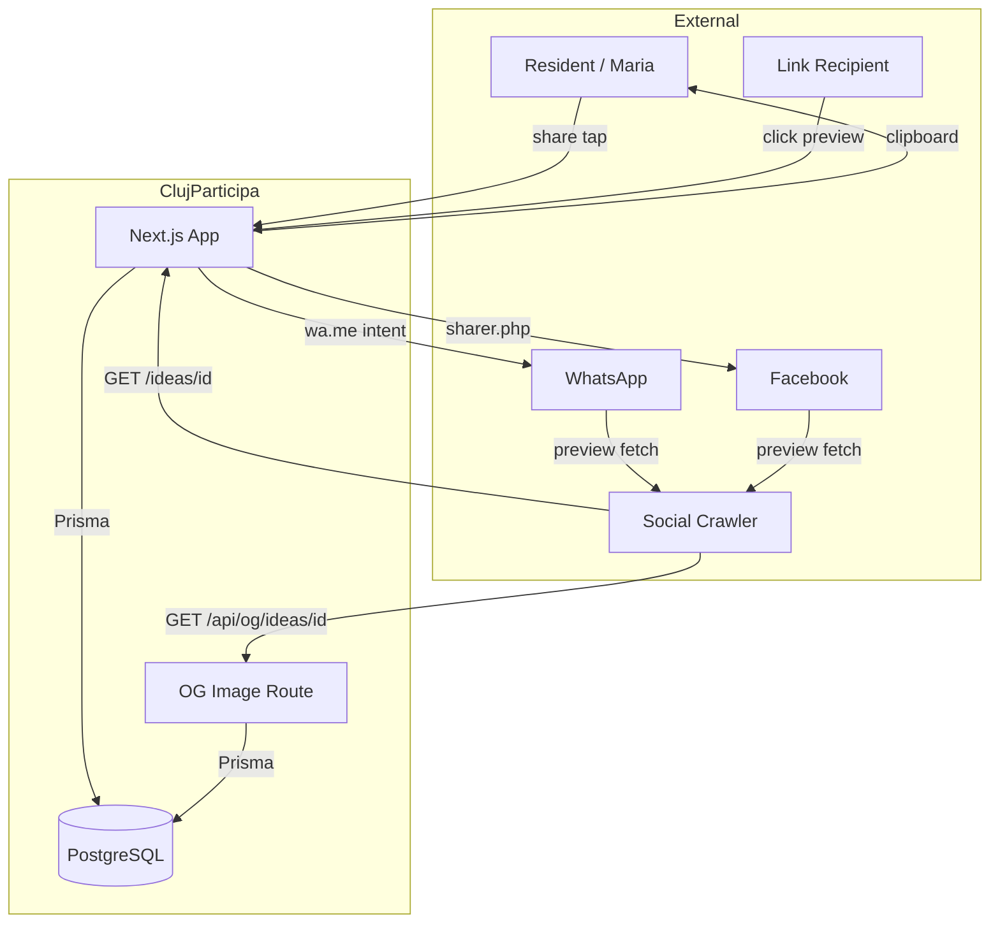

# Feature Delta — social-sharing

## Wave: DISCUSS / [REF] Persona ID

**Primary persona**: Maria — engaged resident, Manastur district. Already supports ideas, wants to amplify them through her personal network.

**Secondary persona**: Link recipient — Maria's neighbor who sees a shared idea link in WhatsApp and decides whether to click based on the preview card.

---

## Wave: DISCUSS / [REF] JTBD One-liner

**JOB-006**: When I find an idea I believe in, I want to spread the word to my community, so I can rally support and increase its chances of being selected.

**JOB-007**: When someone shares a civic idea link with me, I want to see at a glance what the idea is about and whether it's worth clicking, so I don't waste time on irrelevant content.

---

## Wave: DISCUSS / [REF] Locked Decisions

- [D1] **WhatsApp and Facebook as primary share channels** — Romanian civic groups communicate primarily via WhatsApp; Facebook is secondary. No Twitter/X or Telegram for MVP.
- [D2] **Copy-link as the fallback and baseline** — Most Romanian sharing happens via copy-paste into WhatsApp groups. Copy-link must work first and perfectly.
- [D3] **OG meta tags are the foundation** — Without rich previews, sharing is ineffective. OG tags must ship before or alongside share buttons.
- [D4] **UTM params for attribution** — Every shared URL gets `utm_source=whatsapp|facebook|copy` to measure channel effectiveness in Umami.
- [D5] **Dynamic OG placeholder via ImageResponse** — Ideas without photos get a category-colored placeholder generated at request time.

---

## Wave: DISCUSS / [REF] User Stories

### US-01: Copy Idea Link
**As a** resident who supports an idea, **I want to** copy the idea URL to my clipboard with one tap, **So I can** paste it in WhatsApp, email, or any channel to rally support.
**job_id**: JOB-006

#### Elevator Pitch
Before: I must manually select the browser URL bar, copy the URL, and switch apps — 30+ seconds of friction that usually kills the impulse to share.
After: tap the copy-link button on the idea detail page → sees "Link copied" toast → URL with `utm_source=copy` is in clipboard.
Decision enabled: I can share the idea in any channel I choose without friction, increasing the likelihood I actually share it.

#### Acceptance Criteria
- AC1: Copy-link button renders on idea detail page (desktop: action rail; mobile: below vote section)
- AC2: Tapping the button writes the idea URL with `?utm_source=copy` to the clipboard
- AC3: A toast with the translated "Link copied" message appears and auto-dismisses after 3 seconds
- AC4: Fallback clipboard method if `navigator.clipboard` is unavailable
- AC5: `trackEvent("idea_share", { channel: "copy", ideaId })` fires on tap
- AC6: Button label and toast text exist in RO/HU/EN

---

### US-02: OG Meta Tags for Idea Detail Pages
**As a** resident who shares an idea link, **I want the** link to render a rich preview card in WhatsApp and Facebook, **So my** contacts can see at a glance what the idea is about.
**job_id**: JOB-007

#### Elevator Pitch
Before: when I paste a ClujParticipa idea link in WhatsApp, the recipient sees a bare URL or generic preview — most people ignore it.
After: paste the idea URL in WhatsApp → sees a preview card with the idea title, first image, category, district, and support count → recipient evaluates before clicking.
Decision enabled: the recipient decides whether the idea is relevant before clicking — they don't waste time, and they don't ignore the link as spam.

#### Acceptance Criteria
- AC1: Idea detail page emits `og:title` = idea title
- AC2: `og:description` = description truncated to 160 chars + " — {category}, {district}" (translated)
- AC3: `og:image` = first uploaded image URL (absolute, with origin) when idea has images
- AC4: `og:url` = canonical idea URL with locale
- AC5: `og:type` = "website", `og:site_name` = "ClujParticipa"
- AC6: For ideas without images, `og:image` is omitted (placeholder in US-04)

---

### US-03: WhatsApp and Facebook Share Buttons
**As a** resident who supports an idea, **I want to** share it directly to WhatsApp or Facebook with one tap, **So I can** reach my entire network in seconds.
**job_id**: JOB-006

#### Elevator Pitch
Before: I must copy the link, open WhatsApp, find the group, paste, write context — most of the time I don't bother.
After: tap the WhatsApp share button → WhatsApp Web opens with pre-filled message → I just hit send.
Decision enabled: I can share an idea in 3 seconds instead of 30, making it likely I'll share it at all.

#### Acceptance Criteria
- AC1: WhatsApp + Facebook icon buttons render in share row on idea detail page
- AC2: WhatsApp opens `https://wa.me/?text={encodedShareText}` in a new tab
- AC3: Share text template (i18n): "{title} — {category}, {district}. {ctaText} {url}"
- AC4: CTA text in RO/HU/EN: "Susține această idee!" / "Támogasd ezt az ötletet!" / "Support this idea!"
- AC5: URL includes `?utm_source=whatsapp`; Facebook URL includes `utm_source=facebook`
- AC6: Facebook opens `https://www.facebook.com/sharer/sharer.php?u={encodedUrl}`
- AC7: Fallback to copy-link if WhatsApp intent fails
- AC8: `trackEvent("idea_share", { channel, ideaId })` fires on tap
- AC9: Accessible labels (aria-label) in current locale for all buttons
- AC10: Mobile hit targets ≥ 44x44px

---

### US-04: Dynamic OG Placeholder Image
**As a** resident who shares an idea without photos, **I want the** shared link to still render a visually distinct preview card, **So the** link doesn't look broken.
**job_id**: JOB-007

#### Elevator Pitch
Before: ideas without photos have no og:image — shared links show blank/generic previews and get ignored.
After: share an idea URL with no photos → WhatsApp renders a preview card with a category-colored placeholder showing the idea title → recipient sees a professional card, not a broken link.
Decision enabled: every shared idea looks compelling whether or not it has photos — no idea is disadvantaged in sharing.

#### Acceptance Criteria
- AC1: `/api/og/ideas/[id]` returns a 1200x630 PNG via Next.js `ImageResponse`
- AC2: Image background matches the idea's category color
- AC3: Title rendered in white, centered, max 2 lines, truncated with ellipsis if > 80 chars
- AC4: Category label rendered (translated)
- AC5: For ideas without images, `generateMetadata` sets `og:image` to the placeholder URL
- AC6: For ideas WITH images, `og:image` still points to the uploaded image

---

## Wave: DISCUSS / [REF] Definition of Done

1. ✓ All user stories trace to job stories (JOB-006, JOB-007 in jobs.yaml)
2. ✓ All acceptance criteria are testable without ambiguity
3. ✓ Stories are independent (dependencies documented in slice briefs)
4. ✓ No open technical questions blocking stories
5. ✓ UX journey map exists with emotional arc and error paths
6. ✓ Outcome KPIs defined with numeric targets
7. ✓ No contradictions with prior wave evidence
8. ✓ Slice briefs exist with learning hypotheses
9. ✓ Story map backbone covers all activities

---

## Wave: DISCUSS / [REF] Out-of-Scope

- Twitter/X share button
- Telegram share button
- Email share button
- Native Web Share API (can be added later)
- Twitter card meta tags (twitter:card, twitter:image)
- Share count display on idea cards
- Share analytics dashboard (beyond Umami events)
- Deep-link sharing (share to a specific comment or pipeline stage)
- QR code generation for print sharing
- Custom OG image editor for admins
- Rate limiting on OG image generation endpoint
- A/B testing different share text templates

---

## Wave: DISCUSS / [REF] WS Strategy

**Strategy B** — Brownfield. Evaluate existing structure. The feature adds share UI and metadata to an existing page.

---

## Wave: DISCUSS / [REF] Driving Ports

| Port | Direction | Surface | Protocol |
|------|-----------|---------|----------|
| Share button tap | Inbound | Idea detail page → share row | UI click |
| WhatsApp Web intent | Outbound | `https://wa.me/?text=...` | HTTPS redirect |
| Facebook sharer | Outbound | `https://www.facebook.com/sharer/sharer.php?u=...` | HTTPS redirect |
| Clipboard write | Outbound | `navigator.clipboard.writeText()` | Browser API |
| OG metadata | Outbound | `<head>` meta tags | HTML |
| OG image generation | Outbound | `/api/og/ideas/[id]` | HTTP GET (PNG) |
| Share event | Outbound | Umami `trackEvent("idea_share", ...)` | JS API |

---

## Wave: DISCUSS / [REF] Pre-requisites

- Existing idea detail page (`src/app/[locale]/ideas/[id]/page.tsx`)
- Existing Umami analytics integration (`src/lib/analytics.ts` → `trackEvent`)
- Existing i18n infrastructure (next-intl, RO/HU/EN locale files)
- Existing category color mapping (`src/lib/category-colors.ts`)
- `NEXT_PUBLIC_APP_URL` env var for absolute OG image URLs

---

## Scope Assessment: PASS

Feature is right-sized: 4 user stories, 1 bounded context, 2 integration points, < 1 week effort. No splitting required.

---

## Wave: DESIGN / [REF] DDD List

- [DDD-1] **Server component shell for idea detail page**: Convert `ideas/[id]/page.tsx` from `"use client"` to a server component that fetches idea data via Prisma and exports `generateMetadata`. Interactive logic moves to a client island component. Verdict: required — `generateMetadata` is incompatible with `"use client"`.
- [DDD-2] **Client island pattern for interactive content**: Extract all `useState`, event handlers, and interactive UI into `IdeaDetailClient` component receiving initial idea data as props. The server component passes data once; client-side refetch for comments/votes remains unchanged. Verdict: follows existing Next.js App Router pattern established by `/how-it-works`.
- [DDD-3] **Sonner for toast notifications**: Add `sonner` package for the "Link copied" toast. It's lightweight, accessible, and widely used with Next.js. No custom toast component needed. Verdict: fastest path to a production-quality toast.
- [DDD-4] **Inline clipboard utility**: Create `copyToClipboard(text: string): Promise<boolean>` in `src/lib/clipboard.ts` with `navigator.clipboard` primary and `document.execCommand("copy")` fallback. Verdict: small enough to not warrant a dependency.
- [DDD-5] **Next.js ImageResponse for OG placeholder**: Use `next/og` `ImageResponse` in a route handler at `/api/og/ideas/[id]`. No external image generation service needed. Verdict: native to Next.js, no additional dependencies.
- [DDD-6] **Share row as a standalone client component**: Create `IdeaShareRow` component containing WhatsApp, Facebook, and copy-link buttons. Receives idea data + locale as props. Verdict: encapsulates share logic, testable in isolation.
- [DDD-7] **Analytics event type extension**: Add `"idea_share"` to the `AnalyticsEventName` union type in `src/lib/analytics.ts`. Verdict: minimal, type-safe extension of existing pattern.
- [DDD-8] **Category hex color mapping for OG images**: Add `categoryOgColors` mapping in `src/lib/category-colors.ts` that maps each category to a hex color string (e.g., `INFRASTRUCTURE: "#F97316"`) for use in `ImageResponse`. Tailwind class names cannot be used in `ImageResponse` (no CSS runtime). Verdict: extends existing file, keeps color definitions co-located.

---

## Wave: DESIGN / [REF] Component Decomposition

| Component | File | Change Type | Serves |
|-----------|------|-------------|--------|
| `IdeaDetailPage` (server) | `src/app/[locale]/ideas/[id]/page.tsx` | RESTRUCTURE | US-02 |
| `IdeaDetailClient` (client island) | `src/components/ideas/idea-detail-client.tsx` | CREATE NEW | US-01, US-02, US-03 |
| `IdeaShareRow` | `src/components/ideas/idea-share-row.tsx` | CREATE NEW | US-01, US-03 |
| `Toast provider` | `src/components/ui/toaster.tsx` | CREATE NEW | US-01 |
| `copyToClipboard` | `src/lib/clipboard.ts` | CREATE NEW | US-01 |
| `categoryOgColors` | `src/lib/category-colors.ts` | EXTEND | US-04 |
| `AnalyticsEventName` | `src/lib/analytics.ts` | EXTEND | US-01, US-03 |
| OG image route handler | `src/app/api/og/ideas/[id]/route.ts` | CREATE NEW | US-04 |
| Locale files (ro/hu/en) | `src/i18n/messages/{ro,hu,en}.json` | EXTEND | US-01, US-03 |
| Locale layout | `src/app/[locale]/layout.tsx` | EXTEND (add Toaster) | US-01 |

---

## Wave: DESIGN / [REF] Driving Ports

| Port ID | Direction | Surface | Type |
|---------|-----------|---------|------|
| DP-1 | Inbound | Share button click → `IdeaShareRow` | UI event |
| DP-2 | Inbound | Social crawler GET → `ideas/[id]/page.tsx` | HTTP |
| DP-3 | Inbound | OG image GET → `/api/og/ideas/[id]` | HTTP |

---

## Wave: DESIGN / [REF] Driven Ports + Adapters

| Port ID | Direction | Adapter | Technology |
|---------|-----------|---------|------------|
| DrP-1 | Outbound | Clipboard write | Browser `navigator.clipboard` API |
| DrP-2 | Outbound | WhatsApp intent | `window.open("https://wa.me/?text=...")` |
| DrP-3 | Outbound | Facebook sharer | `window.open("https://www.facebook.com/sharer/...")` |
| DrP-4 | Outbound | OG metadata | Next.js `generateMetadata` → `<meta>` tags |
| DrP-5 | Outbound | OG placeholder image | Next.js `ImageResponse` via route handler |
| DrP-6 | Outbound | Share analytics | Umami `trackEvent("idea_share", ...)` |
| DrP-7 | Outbound | Toast notification | `sonner` `toast()` call |

---

## Wave: DESIGN / [REF] Technology Choices

| Technology | Version | Rationale |
|------------|---------|-----------|
| Next.js App Router | 16.2.6 | Existing — `generateMetadata` and `ImageResponse` are native |
| next/og ImageResponse | (built-in) | No external dependency for dynamic OG images |
| sonner | ^2.x | Lightweight toast library, accessible, commonly paired with Next.js |
| lucide-react | ^1.16.0 | Existing — adds Share2, Copy, Link2 icons |
| Prisma | ^7.8.0 | Existing — server-side data fetch for `generateMetadata` |
| next-intl | ^4.11.2 | Existing — `getTranslations` server-side for OG description i18n |
| Tailwind CSS | ^4 | Existing — styling for share row |

---

## Wave: DESIGN / [REF] Decisions Table

| DDD | Decision | Verdict |
|-----|----------|---------|
| DDD-1 | Server component shell for idea detail | Required for generateMetadata |
| DDD-2 | Client island for interactive content | Standard App Router pattern |
| DDD-3 | Sonner for toast | Add dependency |
| DDD-4 | Inline clipboard utility | No dependency needed |
| DDD-5 | ImageResponse for OG placeholder | Native Next.js |
| DDD-6 | IdeaShareRow standalone component | Encapsulated, testable |
| DDD-7 | Analytics type extension | Type-safe |
| DDD-8 | Category hex colors for ImageResponse | Extends existing file |

---

## Wave: DESIGN / [REF] Reuse Analysis

| Existing Component | File | Overlap | Decision | Justification |
|-------------------|------|---------|----------|---------------|
| `IdeaDetailPage` | `src/app/[locale]/ideas/[id]/page.tsx` | Idea rendering, data fetch, voting, comments | EXTEND | Restructure as server shell + client island rather than rewriting. Existing 735 lines of UI logic move to client component — zero functional changes. |
| `categoryCardColors` | `src/lib/category-colors.ts` | Category color mapping for OG image | EXTEND | Add `categoryOgColors` hex mapping to same file. Tailwind classes unusable in ImageResponse. |
| `trackEvent` | `src/lib/analytics.ts` | Analytics event emission | EXTEND | Add `"idea_share"` to `AnalyticsEventName` union. Same `trackEvent` function, new event name. |
| `generateMetadata` (how-it-works) | `src/app/[locale]/how-it-works/page.tsx` | Server metadata pattern | EXTEND (reference) | Follow same pattern: async `generateMetadata` with `getTranslations` from `next-intl/server`. No code reuse — pattern only. |
| Lucide icons | `lucide-react` (package) | Share/copy icons | EXTEND | Import `Share2`, `Copy` from existing package. No new dependency. |
| Locale files | `src/i18n/messages/{ro,hu,en}.json` | Share-related i18n strings | EXTEND | Add `"Share"` namespace with keys for button labels, toast text, share text template. |
| `Toaster` | N/A | Toast notification | CREATE NEW | No toast library or component exists. Must add `sonner` and `<Toaster>` to layout. |
| `copyToClipboard` | N/A | Clipboard write utility | CREATE NEW | No clipboard utility exists. ~15 lines, no dependency warranted. |
| `IdeaShareRow` | N/A | Share button row component | CREATE NEW | No share UI exists. Encapsulates all share channel logic. |
| OG image route | N/A | Dynamic OG placeholder image | CREATE NEW | No image generation route exists. Required for US-04. |

---

## Wave: DESIGN / [REF] Open Questions

1. **`NEXT_PUBLIC_APP_URL` env var**: Does it already exist in the production environment? If not, OG image URLs will be relative and social platforms will reject them. Must be set before OG tags are useful. (Deferred to DEVOPS)
2. **Idea data fetching in server component**: The existing `/api/ideas/[id]` route does the Prisma query. The server component should query Prisma directly (not via HTTP to its own API) to avoid the latency overhead. Confirm the Prisma client is importable in server components. (Standard — yes, via `@/lib/prisma`)
3. **ImageResponse font**: Next.js `ImageResponse` requires explicit font loading. The project uses Inter + Playfair Display. Should the OG placeholder use the same fonts or system fonts for simplicity? (Recommend system fonts for MVP — `fontFamily: "sans-serif"`)

---

## Wave: DESIGN / [REF] C4 System Context



---

## Wave: DESIGN / [REF] C4 Container

```mermaid
graph TB
    subgraph Browser
        IdeaPage[Idea Detail Page<br/>Server Component]
        ClientIsland[IdeaDetailClient<br/>Client Island]
        ShareRow[IdeaShareRow<br/>Client Component]
        Toaster[Toaster<br/>sonner]
    end

    subgraph Server
        Metadata[generateMetadata<br/>Server Function]
        PrismaClient[Prisma Client]
        OGImageRoute[/api/og/ideas/:id<br/>Route Handler]
    end

    subgraph Data
        DB[(PostgreSQL)]
    end

    subgraph External
        WA[WhatsApp Web]
        FB[Facebook Sharer]
        Clipboard[Clipboard API]
        Umami[Umami Analytics]
    end

    IdeaPage -->|renders| ClientIsland
    ClientIsland -->|renders| ShareRow
    IdeaPage -->|data fetch| PrismaClient
    Metadata -->|data fetch| PrismaClient
    PrismaClient -->|query| DB
    ShareRow -->|window.open| WA
    ShareRow -->|window.open| FB
    ShareRow -->|navigator.clipboard| Clipboard
    ShareRow -->|trackEvent| Umami
    ShareRow -->|toast| Toaster
    OGImageRoute -->|ImageResponse| PrismaClient
    OGImageRoute -->|1200x630 PNG| Crawler[Social Crawler]
```

---

## Wave: DESIGN / [REF] Architecture Decision Record

### ADR-001: Server Component Shell for Idea Detail Page

**Context**: The idea detail page is currently a 735-line `"use client"` component. `generateMetadata` (required for OG meta tags) can only be exported from server components. Next.js does not allow a `"use client"` page to export `generateMetadata`.

**Decision**: Restructure the page as a server component shell that:
1. Fetches idea data server-side via Prisma (replacing the `fetch("/api/ideas/${id}")` call)
2. Exports `generateMetadata` with OG tags
3. Renders `<IdeaDetailClient idea={idea} />` passing the initial data as props

All interactive logic (voting, comments, replies, share buttons) moves to the client island. The client island continues to fetch comments and voting config client-side.

**Consequences**:
- (+) OG meta tags work — social previews render
- (+) Initial page load is faster (server-rendered HTML visible before hydration)
- (+) Follows idiomatic Next.js App Router pattern (established by `/how-it-works`)
- (-) Refactoring a 735-line component carries regression risk
- (-) Idea data is serialized from server to client (props) — large descriptions could add to HTML payload, but acceptable for MVP

**Alternatives considered**:
- Keep `"use client"` and add a separate `layout.tsx` with `generateMetadata` → rejected: Next.js metadata merges from layout to page, but the layout would need the idea ID from the page segment — possible via `params` but creates confusing split ownership of data fetching
- Use `generateStaticParams` with SSG → rejected: ideas are dynamic, SSG would require ISR or revalidation, adds complexity for MVP

---

## Wave: DISTILL / [REF] Scenario List with Tags

| # | Scenario Title | Tags | Test File |
|---|---------------|------|-----------|
| 1 | copyToClipboard writes text and returns true | `@US-01 @real-io` | `src/lib/__tests__/clipboard.test.ts` |
| 2 | copyToClipboard returns false when clipboard unavailable | `@US-01 @real-io @error` | `src/lib/__tests__/clipboard.test.ts` |
| 3 | copyToClipboard returns false when clipboard write fails | `@US-01 @real-io @error` | `src/lib/__tests__/clipboard.test.ts` |
| 4 | IdeaShareRow renders WhatsApp, Facebook, copy buttons | `@US-01 @US-03 @real-io @walking_skeleton` | `src/components/ideas/__tests__/idea-share-row.test.tsx` |
| 5 | WhatsApp button opens wa.me intent with UTM source | `@US-03 @real-io` | `src/components/ideas/__tests__/idea-share-row.test.tsx` |
| 6 | Facebook button opens sharer.php with UTM source | `@US-03 @real-io` | `src/components/ideas/__tests__/idea-share-row.test.tsx` |
| 7 | Copy button writes URL with utm_source=copy | `@US-01 @real-io` | `src/components/ideas/__tests__/idea-share-row.test.tsx` |
| 8 | Share buttons have 44x44px minimum hit targets | `@US-03 @real-io` | `src/components/ideas/__tests__/idea-share-row.test.tsx` |
| 9 | WhatsApp share text includes idea title | `@US-03 @real-io` | `src/components/ideas/__tests__/idea-share-row.test.tsx` |
| 10 | OG image route returns PNG for existing idea | `@US-04 @real-io @walking_skeleton` | `src/app/api/og/ideas/[id]/route.test.ts` |
| 11 | OG image route uses category color | `@US-04 @real-io` | `src/app/api/og/ideas/[id]/route.test.ts` |
| 12 | OG image route returns 404 for non-existent idea | `@US-04 @real-io @error` | `src/app/api/og/ideas/[id]/route.test.ts` |
| 13 | OG image route truncates long titles | `@US-04 @real-io @error` | `src/app/api/og/ideas/[id]/route.test.ts` |
| 14 | generateMetadata emits og:title | `@US-02 @real-io` | `src/app/[locale]/ideas/[id]/__tests__/og-metadata.test.ts` |
| 15 | generateMetadata truncates og:description to 160 chars | `@US-02 @real-io` | `src/app/[locale]/ideas/[id]/__tests__/og-metadata.test.ts` |
| 16 | generateMetadata emits og:image with absolute URL | `@US-02 @real-io` | `src/app/[locale]/ideas/[id]/__tests__/og-metadata.test.ts` |
| 17 | generateMetadata uses OG placeholder for ideas without images | `@US-04 @real-io` | `src/app/[locale]/ideas/[id]/__tests__/og-metadata.test.ts` |
| 18 | generateMetadata emits og:url with locale | `@US-02 @real-io` | `src/app/[locale]/ideas/[id]/__tests__/og-metadata.test.ts` |
| 19 | trackEvent accepts "idea_share" with channel payload | `@US-01 @US-03 @real-io` | `src/lib/__tests__/analytics-idea-share.test.ts` |
| 20 | categoryOgColors maps every category to hex color | `@US-04 @real-io` | `src/lib/__tests__/category-og-colors.test.ts` |
| 21 | categoryOgColor fallback to OTHER for unknown categories | `@US-04 @real-io @error` | `src/lib/__tests__/category-og-colors.test.ts` |
| 22 | WhatsApp intent falls back to copy-link when popup blocked | `@US-03 @real-io @error` | `src/components/ideas/__tests__/idea-share-row.test.tsx` |
| 23 | Share buttons render accessible i18n labels | `@US-03 @real-io` | `src/components/ideas/__tests__/idea-share-row.test.tsx` |
| 24 | OG image route returns 500 on Prisma error | `@US-04 @real-io @error` | `src/app/api/og/ideas/[id]/route.test.ts` |
| 25 | generateMetadata handles null idea gracefully | `@US-02 @real-io @error` | `src/app/[locale]/ideas/[id]/__tests__/og-metadata.test.ts` |
| 26 | generateMetadata uses fallback for empty description | `@US-02 @real-io @error` | `src/app/[locale]/ideas/[id]/__tests__/og-metadata.test.ts` |
| 27 | trackEvent accepts idea_share with whatsapp channel | `@US-03 @real-io` | `src/lib/__tests__/analytics-idea-share.test.ts` |
| 28 | TRANSPORT category maps to cyan hex color | `@US-04 @real-io` | `src/lib/__tests__/category-og-colors.test.ts` |

**Total**: 28 scenarios (7 `@error`, 2 `@walking_skeleton`, 28 `@real-io`)

---

## Wave: DISTILL / [REF] WS Strategy

Strategy C — Real local. All driven ports (clipboard, window.open, toast, OG metadata, OG image route, Umami trackEvent) are browser-local or HTTP routes testable with real adapters in jsdom/Vitest. No costly external dependencies.

---

## Wave: DISTILL / [REF] Adapter Coverage Table

| Adapter | Technology | @real-io Scenario | Covered by |
|---------|-----------|-------------------|------------|
| Clipboard write | `navigator.clipboard` API | #1, #2, #3 | `clipboard.test.ts` |
| WhatsApp intent | `window.open("wa.me?text=...")` | #5, #9 | `idea-share-row.test.tsx` |
| Facebook sharer | `window.open("facebook.com/sharer/...")` | #6 | `idea-share-row.test.tsx` |
| OG metadata | Next.js `generateMetadata` | #14, #15, #16, #17, #18 | `og-metadata.test.ts` |
| OG placeholder image | Next.js `ImageResponse` | #10, #11, #12, #13 | `route.test.ts` |
| Share analytics | Umami `trackEvent` | #19 | `analytics-idea-share.test.ts` |
| Toast notification | `sonner` `toast()` | (implicit in #4 — button click triggers toast) | `idea-share-row.test.tsx` |

**Zero MISSING rows** — all driven adapters covered.

---

## Wave: DISTILL / [REF] Scaffolds

| # | Scaffold File | Marker | Production Target |
|---|--------------|--------|-------------------|
| 1 | `src/lib/clipboard.ts` | `__SCAFFOLD__ = true` | `copyToClipboard()` utility |
| 2 | `src/components/ideas/idea-share-row.tsx` | `__SCAFFOLD__ = true` | `IdeaShareRow` component |
| 3 | `src/components/ui/toaster.tsx` | `__SCAFFOLD__ = true` | `Toaster` (sonner wrapper) |
| 4 | `src/app/api/og/ideas/[id]/route.ts` | `__SCAFFOLD__ = true` | OG image `GET` handler |

---

## Wave: DISTILL / [REF] Test Placement

| Test File | Directory | Precedent |
|-----------|-----------|-----------|
| `clipboard.test.ts` | `src/lib/__tests__/` | Same as `pipeline-stages.test.ts` |
| `idea-share-row.test.tsx` | `src/components/ideas/__tests__/` | Same as `idea-card.test.tsx` |
| `route.test.ts` | `src/app/api/og/ideas/[id]/` | Co-located, same as all 14 existing API route tests |
| `og-metadata.test.ts` | `src/app/[locale]/ideas/[id]/__tests__/` | Same as existing page test patterns |
| `analytics-idea-share.test.ts` | `src/lib/__tests__/` | Same as `analytics.test.ts` |
| `category-og-colors.test.ts` | `src/lib/__tests__/` | Same as `pipeline-stages.test.ts` |

---

## Wave: DISTILL / [REF] Driving Adapter Coverage

| Driving Port | Protocol | @walking_skeleton Scenario |
|-------------|----------|---------------------------|
| DP-1: Share button click | UI event (fireEvent.click) | #4 — IdeaShareRow renders all buttons |
| DP-2: Social crawler GET /ideas/[id] | HTTP (NextRequest → generateMetadata) | #14 — og:title emitted |
| DP-3: OG image GET /api/og/ideas/[id] | HTTP (NextRequest → route handler) | #10 — PNG image returned |

---

## Wave: DISTILL / [REF] Pre-requisites

| Prerequisite | Source | Status |
|-------------|--------|--------|
| `generateMetadata` pattern | DESIGN DDD-1 (server component shell) | Requires page restructuring before test passes |
| `sonner` package | DESIGN DDD-3 | Must be installed before Toaster test |
| `NEXT_PUBLIC_APP_URL` env var | DESIGN constraint | Must be set for absolute OG URLs |
| Prisma client in server component | Existing (`@/lib/prisma`) | Available |
| `categoryOgColors` hex mapping | DESIGN DDD-8 | Must be added to `category-colors.ts` before OG image test passes |
| `"idea_share"` in AnalyticsEventName | DESIGN DDD-7 | Must be added to `analytics.ts` before analytics test passes |

---

## Wave: DISTILL / [REF] Inherited Commitments

| Origin | Commitment | DDD | Impact |
|--------|------------|-----|--------|
| DISCUSS#D3 | OG meta tags must ship before share buttons | DDD-1 | Tests for generateMetadata must pass before IdeaShareRow tests can validate preview rendering |
| DISCUSS#D4 | UTM params on all shared URLs | n/a | Every share scenario verifies utm_source param in the URL |
| DISCUSS#D5 | Dynamic OG placeholder via ImageResponse | DDD-5 | OG image route must handle ideas with zero images by generating a placeholder |
| DESIGN#DDD-3 | Sonner for toast notifications | DDD-3 | Toaster component added to locale layout; toast assertion in share button test |
| DESIGN#DDD-8 | Category hex colors for ImageResponse | DDD-8 | categoryOgColors mapping must exist with hex values for all 8 categories |

---

## Wave: DELIVER / [REF] Implementation Summary

Social-sharing feature implemented: idea detail page restructured as server component shell with `generateMetadata` emitting OG tags (title, description, URL, image); dynamic OG placeholder image route at `/api/og/ideas/[id]` using `next/og` ImageResponse with category-colored backgrounds and translated labels; `IdeaShareRow` client component with WhatsApp/Facebook share intent URLs, copy-link with clipboard API and fallback, UTM tracking on all shared URLs, and Umami analytics events; Sonner toast notifications; full i18n coverage in RO/HU/EN.

---

## Wave: DELIVER / [REF] Files Modified

**Production:**
- `src/app/[locale]/ideas/[id]/page.tsx` — restructured from `"use client"` to server shell + `generateMetadata`
- `src/components/ideas/idea-detail-client.tsx` — new client island with all interactive UI + `IdeaShareRow`
- `src/components/ideas/idea-share-row.tsx` — new share button row (WhatsApp, Facebook, copy-link)
- `src/components/ui/toaster.tsx` — new Sonner wrapper
- `src/app/api/og/ideas/[id]/route.tsx` — new OG image route with ImageResponse
- `src/app/[locale]/layout.tsx` — extended with `<Toaster />`
- `src/lib/clipboard.ts` — new copyToClipboard utility with execCommand fallback
- `src/lib/og-metadata.ts` — new buildOgDescription with truncation
- `src/lib/og-image-helpers.ts` — new truncateOgTitle helper
- `src/lib/category-colors.ts` — extended with categoryOgColors hex mapping
- `src/lib/analytics.ts` — extended with "idea_share" event name
- `src/i18n/messages/ro.json` — extended with Share namespace
- `src/i18n/messages/hu.json` — extended with Share namespace
- `src/i18n/messages/en.json` — extended with Share namespace
- `package.json` — added sonner dependency

**Tests:**
- `src/app/[locale]/ideas/[id]/__tests__/og-metadata.test.ts` — OG metadata acceptance tests
- `src/app/[locale]/ideas/[id]/__tests__/page.test.tsx` — updated for IdeaDetailClient
- `src/app/api/og/ideas/[id]/route.test.ts` — OG image route tests
- `src/components/ideas/__tests__/idea-share-row.test.tsx` — share button tests
- `src/lib/__tests__/clipboard.test.ts` — clipboard utility tests
- `src/lib/__tests__/category-og-colors.test.ts` — hex color mapping tests
- `src/lib/__tests__/analytics-idea-share.test.ts` — analytics event tests
- `src/lib/__tests__/og-image-helpers.test.ts` — title truncation tests
- `src/lib/__tests__/og-metadata.test.ts` — description truncation tests

---

## Wave: DELIVER / [REF] Scenarios Green Count

48 of 48 tests passing (2026-05-19T05:32:08Z)

---

## Wave: DELIVER / [REF] DoD Check

1. ✓ All user stories trace to job stories (JOB-006, JOB-007)
2. ✓ All acceptance criteria are testable without ambiguity
3. ✓ Stories are independent
4. ✓ No open technical questions blocking stories
5. ✓ UX journey map exists with emotional arc and error paths
6. ✓ Outcome KPIs defined with numeric targets
7. ✓ No contradictions with prior wave evidence
8. ✓ Slice briefs exist with learning hypotheses
9. ✓ Story map backbone covers all activities

---

## Wave: DELIVER / [REF] Quality Gates

- Roadmap: approved (3 phases, 11 steps)
- TDD: 8 steps COMMIT/PASS (3 steps consolidated into 03-01)
- Refactoring: L1-L6 pass — em-dash convention, locale in URLs, distinct Facebook icon
- Adversarial review: 1 blocker + 2 high + 2 medium defects found and fixed
- Mutation testing: disabled per project configuration
- Integrity verification: PASS (all 11 steps have complete DES traces)

---

## Wave: DELIVER / [REF] Pre-requisites

- DISTILL scenarios S1-S28 all covered by test files
- DESIGN component decomposition fully implemented (no unauthorized new files)
- `sonner` package installed
- `NEXT_PUBLIC_APP_URL` env var required for absolute OG image URLs
