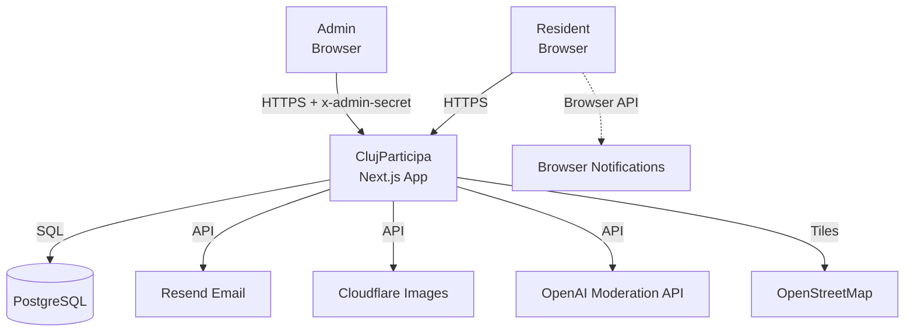

# Architecture Brief — ClujParticipa

## System Context (C4 Level 1)



**External systems**:
- PostgreSQL 16 — primary data store
- Resend — transactional email (status change notifications, existing)
- Cloudflare Images — image storage and CDN (existing)
- OpenAI Moderation API — text toxicity screening for comments (new, inbound)
- OpenStreetMap — map tiles via Leaflet (existing)
- Browser Notification API — push notifications (new, outbound only)

**People**:
- Resident — submits ideas, votes, tracks progress. No account required.
- Admin — manages idea statuses, moderates content. Requires ADMIN_SECRET header.

## Container (C4 Level 2)

```mermaid
graph TB
    Browser[Resident Browser] -->|HTTP/HTTPS| NextJS[Next.js App<br/>App Router]
    AdminBrowser[Admin Browser] -->|HTTP/HTTPS| NextJS

    subgraph "Single Docker Container"
        NextJS
        subgraph "Server Components"
            HomePage[Homepage<br/>Server Component]
            DetailPage[Idea Detail<br/>Server Component]
            HowItWorksPage[How It Works<br/>Server Component]
        end
        subgraph "Client Components"
            Pipeline[PipelineTrack<br/>Client Component]
            MiniPipeline[MiniPipelineTrack<br/>Client Component]
            Timeline[StatusChangeTimeline<br/>Client Component]
            Map[MapView<br/>Client Component]
            HowItWorksContent[HowItWorksContent<br/>Client Component]
        end
        subgraph "API Routes"
            IdeasAPI[/api/ideas]
            StatusChangesAPI[/api/ideas/id/status-changes]
            VoteAPI[/api/ideas/id/vote]
            StatsAPI[/api/stats]
            AdminAPI[/api/admin/ideas/id/status]
        end
        subgraph "Domain Logic"
            Transitions[transitions.ts<br/>Status Machine]
            PipelineStages[pipeline-stages.ts<br/>Stage Ordering]
            PipelineComputation[pipeline-computation.ts<br/>Stage Transforms]
            StalledDetector[stalled-detector.ts<br/>Stalled Detection]
            ActorResolver[actor-role-resolver.ts<br/>Role Resolution]
            ModerationLogic[openai-moderation.ts<br/>Text Moderation]
        end
    end

    NextJS -->|Prisma| DB[(PostgreSQL)]
    NextJS -->|HTTP| Resend[Resend]
    NextJS -->|HTTP| Cloudflare[Cloudflare Images]
    NextJS -->|HTTPS| OpenAI[OpenAI Moderation API]
    Pipeline -->|fetch| StatusChangesAPI
    Pipeline --> PipelineStages
    Pipeline --> PipelineComputation
    Pipeline --> StalledDetector
    MiniPipeline --> PipelineStages
    HowItWorksContent --> Pipeline
    HowItWorksContent --> PipelineStages
    Timeline --> ActorResolver
```

## Application Architecture

### Pattern: Modular monolith with ports-and-adapters

```
┌─────────────────────────────────────────────────────┐
│                  Driving Adapters                     │
│  Next.js Pages (Server Components)                   │
│  API Route Handlers                                   │
│  Browser Notification API (outbound)                  │
├─────────────────────────────────────────────────────┤
│                  Application Layer                    │
│  Pipeline orchestration, stage rendering logic        │
│  Exception state detection, stalled detection         │
│  Actor role resolution, milestone grouping            │
│  Pipeline visual: track+marker rendering (ADR-004)   │
├─────────────────────────────────────────────────────┤
│                  Domain Layer                         │
│  transitions.ts — status machine (SSOT)               │
│  pipeline-stages.ts — stage ordering                  │
│  pipeline-computation.ts — stage data transforms      │
│  stalled-detector.ts — stalled detection rules         │
│  actor-role-resolver.ts — changedBy → role mapping    │
├─────────────────────────────────────────────────────┤
│                  Driven Adapters                      │
│  Prisma (PostgreSQL)                                  │
│  Resend (email)                                       │
│  Cloudflare Images                                    │
│  OpenAI Moderation API (text screening)               │
└─────────────────────────────────────────────────────┘
```

**Dependency rule**: Dependencies point inward. Domain logic has zero imports from adapters. Application layer imports from domain only. Driving adapters import from application layer.

### Component Boundaries

| Boundary | Owns | Imports From |
|----------|------|-------------|
| Pipeline domain | Stage ordering, stalled detection, milestone grouping, exception state detection | transitions.ts (domain peer) |
| Pipeline visual | PipelineTrack, PipelineTrackSegment, MiniPipelineTrack, StalledIndicator, ExceptionState | pipeline domain, i18n messages, motion v12 |
| How It Works page | HowItWorksContent (client), how-it-works page (server) | pipeline visual, pipeline domain, i18n HowItWorks namespace, IntersectionObserver |
| UI presentation | EditorialIdeaCard, LiveBadge, SidebarCta, StatusChangeTimeline, MapView | pipeline visual, pipeline domain, i18n messages |
| Data access | Prisma queries, API route handlers | Domain (status types), Prisma schema |
| Notifications | useNotificationOptIn hook, browser API probe | Browser Notification API (outbound) |
| Comment moderation | openai-moderation.ts (domain), openai-moderation-adapter.ts (adapter), POST comments route (modified), admin PATCH route (modified) | Domain (ModerationResult type), Prisma (ModerationEvent), OpenAI SDK |

### Paradigm: Functional Composition

All domain logic is pure functions. No classes, no inheritance.

- `getStageIndex(status)` → number
- `isStageReached(stage, current)` → boolean
- `detectStalledIdea(status, lastChangeDate, now?)` → StalledInfo
- `resolveActorRole(changedBy)` → ActorRole
- `getMilestoneGroup(currentStatus)` → { submitted: boolean, inVoting: boolean, completed: boolean }

React components are pure renderers of typed props. Side effects isolated in hooks (`useNotificationOptIn`).

### Color System for Pipeline

Pipeline track and marker colors derive from existing design tokens (per ADR-004: solid track with circular markers):

| Stage | Track Fill Color | Marker Color | CSS Token | Badge Variant |
|-------|-----------------|-------------|-----------|---------------|
| SUBMITTED | civic-orange | civic-orange | `--color-civic-orange` | submitted |
| UNDER_REVIEW | civic-orange | civic-orange | `--color-civic-orange` | under_review |
| ELIGIBLE | civic-blue | civic-blue | `--color-civic-blue` | eligible |
| IN_VOTING | purple-700 | purple-700 | (Tailwind default) | in_voting |
| SELECTED | civic-teal | civic-teal | `--color-civic-teal` | selected |
| IN_PROGRESS | civic-teal | civic-teal | `--color-civic-teal` | in_progress |
| COMPLETED | civic-teal | civic-teal | `--color-civic-teal` | completed |
| REJECTED (exception) | N/A (gray beyond rejection) | red-600 | (Tailwind default) | rejected |
| Future (not reached) | gray-200 | border gray-300 | (Tailwind default) | — |
| STALLED indicator | amber-500 | amber-500 | (Tailwind default) | — |
| MERGED indicator | civic-blue-light | civic-blue-light | `--color-civic-blue-light` | — |
| RETURNED indicator | civic-orange-light | civic-orange-light | `--color-civic-orange-light` | — |

No new color tokens introduced. Pipeline track reuses the same color system as Badge and MapView markers.

### MERGED/RETURNED Note Convention

Admins must prefix StatusChange.notes with canonical markers:

| Exception | Prefix | Example |
|----------|--------|---------|
| MERGED | `[MERGED]` | `[MERGED] merged with idea #cm5x8k2q` |
| RETURNED | `[RETURNED]` | `[RETURNED] revision required: add specific location` |
| Plain rejection | No prefix | `Outside city jurisdiction` |

Parsing rule: if the most recent StatusChange for a REJECTED idea has a note starting with `[MERGED]` or `[RETURNED]`, render the corresponding exception UI instead of the default rejection marker.

### Mini-Pipeline Track Milestone Mapping

The 3-marker mini-pipeline track (per ADR-004: solid track with circular markers) groups the 7 forward stages into 3 public-facing milestones:

| Milestone | Mapped Stages | Visual |
|-----------|-------------|--------|
| Submitted | SUBMITTED, UNDER_REVIEW, ELIGIBLE | Filled dot when any of these is current |
| In Voting | IN_VOTING, SELECTED | Filled dot when either is current |
| Completed | IN_PROGRESS, COMPLETED | Filled dot when either is current |

REJECTED ideas show no mini-pipeline track (status badge alone indicates rejection).

### Pipeline Visual Architecture (ADR-004)

The pipeline visual system uses a **solid continuous track with circular markers** metaphor, replacing the previous disconnected-dot design. See ADR-004 for full rationale.

**Components**:

| Component | Path | Role |
|-----------|------|------|
| PipelineTrack | `src/components/ideas/pipeline-track.tsx` | Full 7-stage pipeline on detail page. Horizontal track on desktop, vertical on mobile. Entrance animation (track fill left-to-right, staggered marker fade) |
| PipelineTrackSegment | `src/components/ideas/pipeline-track-segment.tsx` | Single stage within PipelineTrack: colored track segment + circular marker ON bar + label |
| MiniPipelineTrack | `src/components/ideas/mini-pipeline-track.tsx` | Compact 3-milestone track for idea cards. Horizontal always. Same milestone grouping as ADR-003 |

**Replaced components** (deleted):
- `IdeaPipeline` (was `idea-pipeline.tsx`) -- replaced by `PipelineTrack`
- `IdeaPipelineStage` (was `idea-pipeline-stage.tsx`) -- replaced by `PipelineTrackSegment`
- `MiniPipeline` (was `mini-pipeline.tsx`) -- replaced by `MiniPipelineTrack`

**Extended components**:
- `StalledIndicator` -- added `fullWidth` prop to align stalled bar width with track width

**Unchanged components**:
- `ExceptionState` -- placement below pipeline unaffected
- `pipeline-computation.ts` -- `computePipelineStages()`, `resolveExceptionType()` unchanged
- `pipeline-stages.ts` -- `PIPELINE_STAGES`, `getStageIndex()` unchanged

**Animation contract** (entrance only, no transition on status change):
- Track fill: `motion.div` `scaleX: 0 -> 1`, `transformOrigin: left`, `duration: 0.6s`
- Marker stagger: `motion.div` `opacity: 0 -> 1`, `delay: index * 0.05s`
- Reduced motion: handled by `motion` v12 built-in `prefers-reduced-motion` support

### Homepage Layout Restructure

Current layout: `1fr 400px` grid (idea feed left, map sidebar right).

New layout:

```
┌────────────────────────────────────────┐
│           MAP HERO (full-width)         │
│     HomeMapPreview at 400-500px height   │
│     Tap to submit with location         │
├────────────────────────────────────────┤
│  "Track your idea's progress"           │
│  Stats bar (completed count, etc.)       │
├────────────────────────────────────────┤
│  Idea feed with MiniPipeline indicators │
│  (existing IdeaListRow + MiniPipeline)   │
└────────────────────────────────────────┘
```

Map moves from sidebar to hero. Stats strip moves below map. Idea feed stays but gains mini-pipelines. Mobile: map is full-width and visible (remove `hidden lg:block`).

### Status Pipeline Redesign (10-Status State Machine)

The pipeline transitions from an 8-status enum (SUBMITTED, UNDER_REVIEW, ELIGIBLE, IN_VOTING, SELECTED, IN_PROGRESS, COMPLETED, REJECTED) to a 10-status enum with a cleaner flow and real terminal states.

**New 10-status enum:** SUBMITTED, IN_VOTING, SELECTED, ACCEPTED, IN_PROGRESS, COMPLETED, REJECTED, NEEDS_REVISION, MERGED, WITHDRAWN.

**Removed:** UNDER_REVIEW (feasibility is the authority decision at SELECTED), ELIGIBLE (was a yes/no check, not a stage).

**Added:** ACCEPTED (bridge between SELECTED and IN_PROGRESS), NEEDS_REVISION (terminal, replaces `[RETURNED]` prefix hack), MERGED (terminal, replaces `[MERGED]` prefix hack), WITHDRAWN (terminal, citizen-initiated within 24h).

**Active flow:** SUBMITTED --(24h auto)--> IN_VOTING --(threshold auto | admin)--> SELECTED --(admin)--> ACCEPTED --> IN_PROGRESS --> COMPLETED

**Terminal states:** REJECTED, NEEDS_REVISION, MERGED, WITHDRAWN (no way out, render via ExceptionState only).

**New components:**
- `GET /api/cron/transition-submitted` -- cron endpoint for 24h auto-transition, protected by CRON_SECRET
- `POST /api/ideas/[id]/withdraw` -- citizen withdrawal endpoint, validates 24h window
- `mergedIntoIdeaId` column on Idea model -- optional String for MERGED parent reference

**Migration:** Two-phase additive-first. Phase 1: add 4 new enum values (zero downtime). Phase 2: migrate UNDER_REVIEW/ELIGIBLE ideas to IN_VOTING, rebuild enum without old values (brief maintenance window).

**Domain logic impact:** transitions.ts (rewrite for new graph), pipeline-computation.ts (simplify -- status itself is authoritative for exception type, no more note-prefix parsing for type detection), pipeline-stages.ts (6 forward stages instead of 7), stalled-detector.ts (update maps for 10 states).

**Visual/presentation impact:** PipelineTrack, MiniPipelineTrack, ExceptionState, Badge, status.ts all extend to handle new statuses. The visual metaphor (solid track with markers) is unchanged. Terminal statuses render via ExceptionState below the pipeline, not on the forward track.

**Changed assumptions from prior DESIGN wave:**
- D2 (MERGED/RETURNED via note prefix) -- superseded: MERGED and NEEDS_REVISION are real statuses now
- D7 (no new API endpoints or data models) -- superseded: new cron endpoint, withdraw endpoint, mergedIntoIdeaId column

### Social Sharing Architecture

**Feature**: social-sharing — WhatsApp/Facebook share buttons + OG meta tags + dynamic OG placeholder images

**Key architectural change**: The idea detail page (`src/app/[locale]/ideas/[id]/page.tsx`) must be restructured from a `"use client"` component (735 lines) to a **server component shell + client island** pattern. This is required because `generateMetadata` (for OG tags) can only be exported from server components in Next.js App Router.

**Restructuring plan**:

| Before | After |
|--------|-------|
| Single `"use client"` page component | Server component (page.tsx) + `IdeaDetailClient` (client island) |
| Client-side `fetch("/api/ideas/${id}")` | Server-side Prisma query in page.tsx |
| No `generateMetadata` | `generateMetadata` exports OG title/description/image/url |
| All `useState` in one file | Interactive state moves to `IdeaDetailClient` |
| Comments/voting-config fetched in `useEffect` | Same (client-side fetch remains for interactive data) |

**New components**:

| Component | Path | Role |
|-----------|------|------|
| IdeaDetailClient | `src/components/ideas/idea-detail-client.tsx` | Client island: all interactive UI (voting, comments, replies, share) |
| IdeaShareRow | `src/components/ideas/idea-share-row.tsx` | Share button row: WhatsApp + Facebook + copy-link |
| Toaster | `src/components/ui/toaster.tsx` | Sonner toast wrapper for "Link copied" notification |
| OG image route | `src/app/api/og/ideas/[id]/route.ts` | Dynamic OG placeholder image via `next/og` ImageResponse |
| copyToClipboard | `src/lib/clipboard.ts` | Clipboard write utility (navigator.clipboard + fallback) |

**Extended components**:

| Component | Change |
|-----------|--------|
| `src/lib/analytics.ts` | Add `"idea_share"` to `AnalyticsEventName` union |
| `src/lib/category-colors.ts` | Add `categoryOgColors` hex mapping for ImageResponse |
| `src/i18n/messages/{ro,hu,en}.json` | Add `"Share"` namespace |
| `src/app/[locale]/layout.tsx` | Add `<Toaster />` from sonner |

**External integrations**:

| Integration | Protocol | Purpose |
|-------------|----------|---------|
| WhatsApp Web | `window.open("https://wa.me/?text=...")` | One-tap share with pre-filled text |
| Facebook | `window.open("https://www.facebook.com/sharer/sharer.php?u=...")` | One-tap share via sharer.php |
| Clipboard API | `navigator.clipboard.writeText()` | Copy-link fallback |
| Umami | `trackEvent("idea_share", { channel, ideaId })` | Share attribution |
| Social crawlers | HTTP GET → OG meta tags | Rich link previews |

**ADR-001 (social-sharing)**: Server component shell for idea detail page — see `docs/feature/social-sharing/feature-delta.md`

### AI Comment Moderation Architecture

**Feature**: ai-comment-moderation -- automatic toxicity screening on comment creation via OpenAI Moderation API, with fail-open resilience and full audit trail.

**Quality attribute priorities**: Latency (<2s added) > Reliability (fail-open, 100% comment creation during outage) > Auditability (full ModerationEvent trail) > Maintainability (extend existing patterns).

**C4 System Context update**: OpenAI Moderation API added as external system. Inbound HTTPS call from Next.js container. Labeled "Screens text via" in diagram.

**Architecture decision**: Extend existing comment POST and admin PATCH routes. No new routes. One new domain function (`moderateText` in `src/lib/openai-moderation.ts`). One new driven adapter (`callOpenAIModeration` in `src/lib/openai-moderation-adapter.ts`). Both follow functional composition paradigm (ADR-001).

**Data model changes** (additive migration, zero downtime):

| Model | Change |
|-------|--------|
| `CommentStatus` enum | Add `FLAGGED` |
| `ModerationAction` enum | Add `AUTO_FLAG`, `APPROVE` |

**Flow on comment creation** (`POST /api/ideas/[id]/comments`):

```
resident POSTs comment
  -> existing validation, auth, rate-limit (unchanged)
  -> moderateText(text)
       -> callOpenAIModeration(text) via adapter
            -> OpenAI API (5s timeout)
       -> returns { flagged, categories }
  -> flagged?  yes -> save with status=FLAGGED, create AUTO_FLAG ModerationEvent, return 202
               no  -> save with status=VISIBLE, return 201 (existing behavior)
               error -> save with status=VISIBLE, log warning, return 201 (fail-open)
```

**Flow on admin review** (`PATCH /api/admin/comments/[id]`):

```
admin PATCHes flagged comment
  -> existing auth check (unchanged)
  -> FLAGGED -> VISIBLE: action=APPROVE, create ModerationEvent
  -> FLAGGED -> HIDDEN: action=HIDE, create ModerationEvent
  -> existing VISIBLE/HIDDEN transitions: unchanged
```

**Probe contract** (Earned Trust):

`probeOpenAI()` in adapter file. Validates OPENAI_API_KEY at startup. Exercises one real API call. Non-blocking on failure (consistent with fail-open). Three enforcement layers: subtype (TypeScript interface), structural (AST hook checking for probe export), behavioral (CI gold-test with mocked API scenarios).

**External integration annotation**: Contract tests recommended for OpenAI Moderation API -- consumer-driven contracts to detect breaking changes (e.g., category renames, response schema changes). MVP mitigation: integration test with recorded response fixture in CI.

**Architectural enforcement**: Existing `tsc --noEmit` + `eslint` in CI. For this feature: add AST pre-commit hook scanning adapter file for `probeOpenAI` export. See ADR-005 for full rationale.
