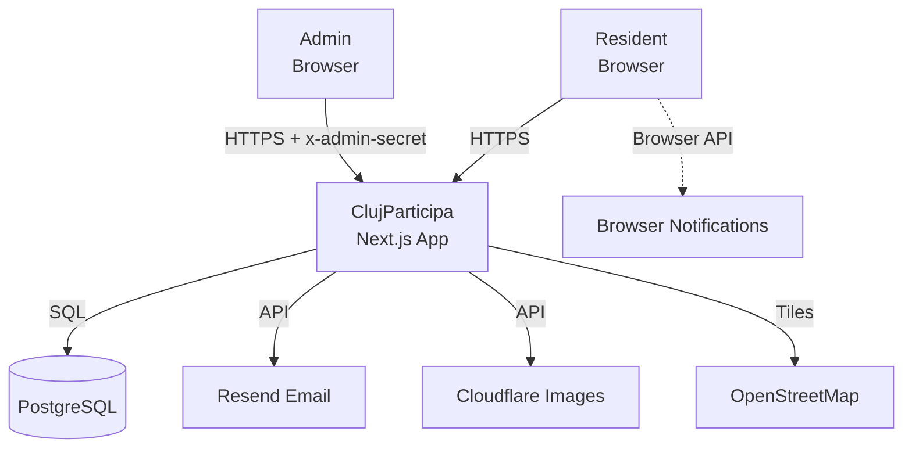

# Architecture Brief — ClujParticipa

## System Context (C4 Level 1)



**External systems**:
- PostgreSQL 16 — primary data store
- Resend — transactional email (status change notifications, existing)
- Cloudflare Images — image storage and CDN (existing)
- OpenStreetMap — map tiles via Leaflet (existing)
- Browser Notification API — push notifications (new, outbound only)

**People**:
- Resident — submits ideas, votes, tracks progress. No account required.
- Admin — manages idea statuses, moderates content. Requires ADMIN_SECRET header.

## Container (C4 Level 2)

```mermaid
graph TB
    Browser[Resident Browser] -->|HTTP/HTTPS| NextJS[Next.js App<br/>App Router]
    AdminBrowser[Admin Browser] -->|HTTP/HTTPS| NextJS

    subgraph "Single Docker Container"
        NextJS
        subgraph "Server Components"
            HomePage[Homepage<br/>Server Component]
            DetailPage[Idea Detail<br/>Server Component]
        end
        subgraph "Client Components"
            Pipeline[IdeaPipeline<br/>Client Component]
            MiniPipeline[MiniPipeline<br/>Client Component]
            Timeline[StatusChangeTimeline<br/>Client Component]
            Map[MapView<br/>Client Component]
        end
        subgraph "API Routes"
            IdeasAPI[/api/ideas]
            StatusChangesAPI[/api/ideas/id/status-changes]
            VoteAPI[/api/ideas/id/vote]
            StatsAPI[/api/stats]
            AdminAPI[/api/admin/ideas/id/status]
        end
        subgraph "Domain Logic"
            Transitions[transitions.ts<br/>Status Machine]
            PipelineStages[pipeline-stages.ts<br/>Stage Ordering]
            StalledDetector[stalled-detector.ts<br/>Stalled Detection]
            ActorResolver[actor-role-resolver.ts<br/>Role Resolution]
        end
    end

    NextJS -->|Prisma| DB[(PostgreSQL)]
    NextJS -->|HTTP| Resend[Resend]
    NextJS -->|HTTP| Cloudflare[Cloudflare Images]
    Pipeline -->|fetch| StatusChangesAPI
    Pipeline --> PipelineStages
    Pipeline --> StalledDetector
    Timeline --> ActorResolver
```

## Application Architecture

### Pattern: Modular monolith with ports-and-adapters

```
┌─────────────────────────────────────────────────────┐
│                  Driving Adapters                     │
│  Next.js Pages (Server Components)                   │
│  API Route Handlers                                   │
│  Browser Notification API (outbound)                  │
├─────────────────────────────────────────────────────┤
│                  Application Layer                    │
│  Pipeline orchestration, stage rendering logic        │
│  Exception state detection, stalled detection         │
│  Actor role resolution, milestone grouping            │
├─────────────────────────────────────────────────────┤
│                  Domain Layer                         │
│  transitions.ts — status machine (SSOT)               │
│  pipeline-stages.ts — stage ordering                  │
│  stalled-detector.ts — stalled detection rules         │
│  actor-role-resolver.ts — changedBy → role mapping    │
├─────────────────────────────────────────────────────┤
│                  Driven Adapters                      │
│  Prisma (PostgreSQL)                                  │
│  Resend (email)                                       │
│  Cloudflare Images                                    │
└─────────────────────────────────────────────────────┘
```

**Dependency rule**: Dependencies point inward. Domain logic has zero imports from adapters. Application layer imports from domain only. Driving adapters import from application layer.

### Component Boundaries

| Boundary | Owns | Imports From |
|----------|------|-------------|
| Pipeline domain | Stage ordering, stalled detection, milestone grouping, exception state detection | transitions.ts (domain peer) |
| UI presentation | IdeaPipeline, MiniPipeline, StatusChangeTimeline, StalledIndicator, ExceptionState | pipeline domain, i18n messages |
| Data access | Prisma queries, API route handlers | Domain (status types), Prisma schema |
| Notifications | useNotificationOptIn hook, browser API probe | Browser Notification API (outbound) |

### Paradigm: Functional Composition

All domain logic is pure functions. No classes, no inheritance.

- `getStageIndex(status)` → number
- `isStageReached(stage, current)` → boolean
- `detectStalledIdea(status, lastChangeDate, now?)` → StalledInfo
- `resolveActorRole(changedBy)` → ActorRole
- `getMilestoneGroup(currentStatus)` → { submitted: boolean, inVoting: boolean, completed: boolean }

React components are pure renderers of typed props. Side effects isolated in hooks (`useNotificationOptIn`).

### Color System for Pipeline

Pipeline stage colors derive from existing design tokens and Badge variants:

| Stage | Fill Color | CSS Token | Badge Variant |
|-------|-----------|-----------|---------------|
| SUBMITTED | civic-orange | `--color-civic-orange` | submitted |
| UNDER_REVIEW | civic-orange | `--color-civic-orange` | under_review |
| ELIGIBLE | civic-blue | `--color-civic-blue` | eligible |
| IN_VOTING | purple-700 | (Tailwind default) | in_voting |
| SELECTED | civic-teal | `--color-civic-teal` | selected |
| IN_PROGRESS | civic-teal | `--color-civic-teal` | in_progress |
| COMPLETED | civic-teal | `--color-civic-teal` | completed |
| REJECTED (exception) | red-600 | (Tailwind default) | rejected |
| STALLED indicator | amber-500 | (Tailwind default) | — |
| MERGED indicator | civic-blue-light | `--color-civic-blue-light` | — |
| RETURNED indicator | civic-orange-light | `--color-civic-orange-light` | — |

No new color tokens introduced. Pipeline reuses the same color system as Badge and MapView markers.

### MERGED/RETURNED Note Convention

Admins must prefix StatusChange.notes with canonical markers:

| Exception | Prefix | Example |
|----------|--------|---------|
| MERGED | `[MERGED]` | `[MERGED] merged with idea #cm5x8k2q` |
| RETURNED | `[RETURNED]` | `[RETURNED] revision required: add specific location` |
| Plain rejection | No prefix | `Outside city jurisdiction` |

Parsing rule: if the most recent StatusChange for a REJECTED idea has a note starting with `[MERGED]` or `[RETURNED]`, render the corresponding exception UI instead of the default rejection marker.

### Mini-Pipeline Milestone Mapping

The 3-dot mini-pipeline groups the 7 forward stages into 3 public-facing milestones:

| Milestone | Mapped Stages | Visual |
|-----------|-------------|--------|
| Submitted | SUBMITTED, UNDER_REVIEW, ELIGIBLE | Filled dot when any of these is current |
| In Voting | IN_VOTING, SELECTED | Filled dot when either is current |
| Completed | IN_PROGRESS, COMPLETED | Filled dot when either is current |

REJECTED ideas show no mini-pipeline (status badge alone indicates rejection).

### Homepage Layout Restructure

Current layout: `1fr 400px` grid (idea feed left, map sidebar right).

New layout:

```
┌────────────────────────────────────────┐
│           MAP HERO (full-width)         │
│     HomeMapPreview at 400-500px height   │
│     Tap to submit with location         │
├────────────────────────────────────────┤
│  "Track your idea's progress"           │
│  Stats bar (completed count, etc.)       │
├────────────────────────────────────────┤
│  Idea feed with MiniPipeline indicators │
│  (existing IdeaListRow + MiniPipeline)   │
└────────────────────────────────────────┘
```

Map moves from sidebar to hero. Stats strip moves below map. Idea feed stays but gains mini-pipelines. Mobile: map is full-width and visible (remove `hidden lg:block`).
